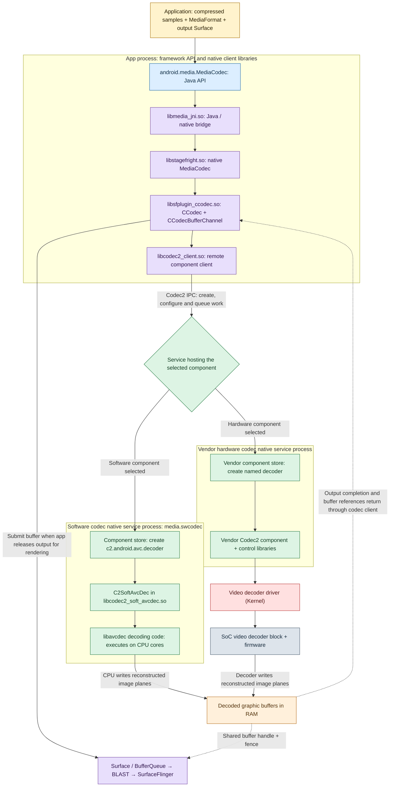

# Android video decoding: MediaCodec, native libraries and services

Scope: normal online MP4 video playback to a Surface, focusing on the **Codec2 decoding stack**. Library mappings below were checked against AOSP vendor binaries, service names and IPC versions vary by product. The reference remains [VideoPlayerActivity.java](https://github.com/mertechlog/android-platform-graphics/blob/main/sample/VideoPlayerActivity.java).

## 1. Application context — briefly

The application fetches MP4 bytes, uses `MediaExtractor` to obtain a video track's compressed samples and format, selects a decoder, and feeds `MediaCodec`. A `SurfaceView` supplies its output Surface. MP4 is the container; H.264/AVC is the example video coding format used below. Networking and container parsing are upstream of decoding.

## 2. Native architecture and process boundaries



The two service boxes are alternatives for a selected decoder session. A service can host multiple component instances. The routing diamond describes component-to-service resolution, not per-frame hardware/software switching. Arrows represent work, control or buffer references; they do not imply full image copies across IPC.

## 3. What the MediaCodec API actually controls

`android.media.MediaCodec` exposes a decoder session. It manages state, configuration, input/output ownership and notifications; its Java methods do not implement the video reconstruction algorithm. [1]

| API operation | Meaning for video decoding |
| --- | --- |
| `createByCodecName(name)` | Requests one named implementation. A component name identifies a registered codec, not a shared-library filename. |
| `configure(format, surface, null, 0)` | Supplies stream parameters and selects Surface output. Codec initialization data can be carried in the `MediaFormat`. |
| `start()` | Starts processing and makes codec buffers available. |
| `dequeueInputBuffer()` / `getInputBuffer()` | Obtains writable memory for a compressed input sample. |
| `queueInputBuffer()` | Submits sample bytes, size, timestamp and flags. Input is compressed video, not an MP4 file or decoded image. |
| `dequeueOutputBuffer()` | Retrieves a completed output reference and `BufferInfo`; asynchronous callback mode is an alternative. |
| `releaseOutputBuffer(index, targetNs)` | Returns the output and requests timed rendering to the configured Surface. `false` in the boolean overload discards it instead. |
| `flush()` / `stop()` / `release()` | Discards queued work, stops processing or destroys the codec session, respectively; these have different lifecycle effects. |

With Surface output, the application normally does not obtain a decoded-pixel `ByteBuffer`. Holding dequeued outputs indefinitely exhausts available output capacity and stalls progress. Output release requests presentation; it does not guarantee the exact panel scanout time.

## 4. Native libraries: names, classes and responsibilities

These are the relevant libraries, not an exhaustive list of transitive dependencies. A class, library, executable and running service are different entities. [2–7]

| Library / build module | Important code or object | Responsibility / typical execution location |
| --- | --- | --- |
| `libmedia_jni.so` | `android_media_MediaCodec.cpp`, `JMediaCodec` | Marshals Java calls and events to/from native code in the app process. |
| `libstagefright.so` | Native `MediaCodec`, `MediaCodec.cpp` | Session state machine, backend creation, messages and resource/error handling in the client process. |
| `libsfplugin_ccodec.so` | `CCodec`, `CCodecBufferChannel`, configuration helpers | Adapts MediaCodec operations to Codec2; manages codec configuration, input/output conversion and Surface submission in the client process. |
| `libcodec2_client.so` | `Codec2Client`, client-side component wrappers | Discovers/connects to Codec2 services and handles remote component operations. Android 15's build also includes transport-specific HIDL client support; interface/version is platform-dependent. |
| `libcodec2_vndk.so` | Codec2 platform store, allocator and block-pool support | Provides native component-store/buffer infrastructure used by the relevant service and client paths. |
| `libcodec2_soft_common` | Common software component support | Build dependency providing reusable software-component infrastructure; not itself an AVC decoder. |
| `libcodec2_soft_avcdec.so` | `C2SoftAvcDec` | Software AVC component wrapper loaded by the software codec service. |
| `libavcdec` | libavc decoder implementation | Performs AVC reconstruction on CPU. It is a **static dependency** of the AVC component in the checked build, so do not assume a separate `libavc.so` or `libavcdec.so` is loaded at runtime. |
| Vendor Codec2/control libraries | Product-specific component and device-control code | Implements the hardware-backed component in the vendor codec service. There is no universal vendor decoder `.so` filename. |
| `libgui.so`, `libui.so` | Surface/BufferQueue/BLAST; GraphicBuffer support | Connects codec output to graphics buffer handling. These libraries do not decode compressed video. |

Useful source locations, relative to the AOSP checkout:

| Area | Directory |
| --- | --- |
| Media JNI | `frameworks/base/media/jni/` |
| Native MediaCodec | `frameworks/av/media/libstagefright/` |
| Codec2 adapter | `frameworks/av/media/codec2/sfplugin/` |
| Codec2 client/transport | `frameworks/av/media/codec2/hal/client/` |
| Software AVC component | `frameworks/av/media/codec2/components/avc/` |
| AVC algorithm implementation | `external/libavc/` |
| Platform component store/buffer support | `frameworks/av/media/codec2/vndk/` |

## 5. What runs inside a native codec service?

A Codec2 service exposes a component store, which advertises components and creates the requested component instance. The instance accepts configuration and queued work containing compressed-buffer references, timestamps and flags, then reports completion and output buffers through its listener. Binder/IPC dispatch and component processing can use different threads. [6, 8, 9]

### Software service

AOSP's `media.swcodec` init service runs the `mediaswcodec` executable from the `com.android.media.swcodec` APEX. Its platform store loads software component modules. For AVC, `C2SoftAvcDec` calls libavc's decoder entry points to parse the compressed stream and reconstruct image planes. The calculations execute on CPU cores **inside the service process**. A decoding library is executable code loaded into that process, not another daemon. [5, 8, 10]

### Vendor hardware service

The vendor service hosts the hardware-backed component, validates/configures jobs, arranges input/output buffers, submits work through its device interface, and reports results. The decoder driver **(Kernel)** handles device access, mappings and job/completion mechanisms. Firmware and dedicated decoder circuitry perform the main reconstruction work; CPU-side work depends on the implementation.

Thus the service provides a decoding operation in both cases, but the location of the decoding computation differs. The software path executes algorithm code in its process; the hardware path coordinates the SoC decoder engine. A service process is not a hardware unit.

## 6. Who selects software versus hardware?

Selection has three distinct levels. [11, 12]

| Level | Decision maker | Decision |
| --- | --- | --- |
| Product integration | Device vendor / Android product configuration | Which codecs exist, their capabilities, component stores, priority/rank and vendor driver bindings. |
| Playback session | Application/player using the framework codec list | Which compatible registered component name to request. |
| Component execution | Selected component, its libraries and driver | How to execute work on CPU or the device engine already associated with that component. |

In the reference sample:

```java
String name = new MediaCodecList(MediaCodecList.REGULAR_CODECS)
        .findDecoderForFormat(format);
MediaCodec codec = MediaCodec.createByCodecName(name);
```

The framework returns a compatible decoder from the device's ordered codec list. Capabilities and ordering come from component information and product configuration, including codec XML data. Hardware codecs are commonly preferred, but **this call does not explicitly request hardware**. It also does not benchmark every decoder or guarantee success when creating/configuring a busy device resource.

For an explicit policy, enumerate `MediaCodecInfo`, exclude encoders, check supported MIME/format, and filter using `isHardwareAccelerated()` or `isSoftwareOnly()` before creating the chosen name. These classification methods require API 29+. `isVendor()` only identifies vendor origin; vendor-provided does not necessarily mean hardware-accelerated. The hardware classification is manufacturer-reported. [13]

If a selected hardware codec cannot be created/configured, retrying another component is a separate player/framework behavior. The sample does not implement a fallback loop. Do not assume a running named session automatically changes to a software decoder.

## 7. Which physical chip performs hardware decoding?

MediaCodec normally selects a **registered component**, not a chip from a list. The board already contains a particular SoC; its vendor component is integrated with that platform's video decoder driver and hardware block. A device tree/platform description and driver binding identify the physical device; the vendor implementation determines its use.

The decoder is usually an IP block inside the SoC, distinct from CPU cores, the GPU and the display controller. If several codec engines exist, scheduling between them is an implementation detail below the public MediaCodec API.

### Registered component examples

| Component name | What the name identifies | Public evidence |
| --- | --- | --- |
| `c2.android.avc.decoder` | AOSP software AVC component | AOSP software component/store sources. |
| `c2.qti.avc.decoder` | Qualcomm-family vendor AVC component | Listed in Google's `redbull` codec configuration. Its name alone does not identify an exact Snapdragon model. |
| `c2.exynos.h264.decoder` | Exynos-family vendor H.264 component | Listed in Google's `gs201` codec configuration. A vendor prefix should not be treated as the phone's marketing chipset name. |

Sources: [8, 14, 15]. Names are examples observed in specific product trees, not names guaranteed on all devices from those vendors.

### Concrete silicon/driver examples

| Platform example | Decoder hardware evidence | What this establishes |
| --- | --- | --- |
| Qualcomm SM8250 | Kernel Venus driver has an entry for `qcom,sm8250-venus`. | A concrete SoC video-decoder integration exists; it does not establish that every Qualcomm product uses this driver or that `redbull` contains this SoC. |
| Samsung Exynos4 family | Kernel MFC binding documents MFC v5 for Exynos4 SoCs. | MFC is a dedicated video codec block; this older example is not a claim about the exact decoder generation in `gs201`. |

Sources: [16, 17]. The tables deliberately distinguish a registered Android component from a verified silicon/driver binding: neither alone proves the complete mapping on a particular phone or AAOS board.

## 8. Identify the actual implementation on your device

Start with the selected session rather than guessing from the SoC brand:

```java
Log.i("Codec", "Selected component: " + codec.getName());
if (android.os.Build.VERSION.SDK_INT >= 29) {
    MediaCodecInfo info = codec.getCodecInfo();
    Log.i("Codec", "hardware=" + info.isHardwareAccelerated()
            + ", software=" + info.isSoftwareOnly()
            + ", vendor=" + info.isVendor());
}
```

While playback is running, these host commands can help correlate the component, service and board:

```bash
adb shell dumpsys media.codec
adb shell ps -A
adb shell getprop ro.board.platform
adb logcat -s CCodec Codec2Client MediaCodec
```

Dump detail, process visibility and log tags vary by build. To prove the exact hardware mapping, correlate the selected codec with vendor configuration/implementation, the codec process's loaded libraries, driver activity and the board's hardware description. Process maps and driver traces may require a userdebug/root build. Public codec flags do not expose an exact physical decoder-core identifier.

## 9. Boundary after decoding

The result is a graphic buffer, commonly containing YUV planes, with metadata and synchronization. Gralloc/block-pool infrastructure manages compatible allocations; DMA-BUF is commonly used for sharing. Software output may require copying/conversion, while hardware can often write a shareable output allocation directly; zero-copy is not universal.

Once released for rendering, the frame reaches the configured Surface's BufferQueue, then BLAST and SurfaceFlinger in the modern path. HWC/optional GPU composition and display scanout follow. That display pipeline consumes decoded images; it does not perform AVC decoding.

## Sources

1. [MediaCodec API](https://developer.android.com/reference/android/media/MediaCodec)
2. [Media JNI build](https://android.googlesource.com/platform/frameworks/base/+/android-15.0.0_r16/media/jni/Android.bp)
3. [Native MediaCodec / Stagefright build](https://android.googlesource.com/platform/frameworks/av/+/android-15.0.0_r16/media/libstagefright/Android.bp)
4. [CCodec plugin build](https://android.googlesource.com/platform/frameworks/av/+/android-15.0.0_r16/media/codec2/sfplugin/Android.bp)
5. [Software AVC component build, including static libavcdec dependency](https://android.googlesource.com/platform/frameworks/av/+/android-15.0.0_r16/media/codec2/components/avc/Android.bp)
6. [Codec2 client build](https://android.googlesource.com/platform/frameworks/av/+/android-15.0.0_r16/media/codec2/hal/client/Android.bp)
7. [Codec2 platform support build](https://android.googlesource.com/platform/frameworks/av/+/android-15.0.0_r16/media/codec2/vndk/Android.bp)
8. [Platform component store](https://android.googlesource.com/platform/frameworks/av/+/android-15.0.0_r16/media/codec2/vndk/C2Store.cpp)
9. [CCodec implementation](https://android.googlesource.com/platform/frameworks/av/+/android-15.0.0_r16/media/codec2/sfplugin/CCodec.cpp)
10. [Software codec init service](https://android.googlesource.com/platform/frameworks/av/+/android-15.0.0_r16/apex/mediaswcodec.rc)
11. [MediaCodecList API](https://developer.android.com/reference/android/media/MediaCodecList)
12. [Native codec list implementation](https://android.googlesource.com/platform/frameworks/av/+/master/media/libstagefright/MediaCodecList.cpp)
13. [MediaCodecInfo classification APIs](https://developer.android.com/reference/android/media/MediaCodecInfo)
14. [Qualcomm component example: redbull configuration](https://android.googlesource.com/device/google/redbull/+/refs/heads/android12L-security-release/media_codecs_performance_c2.xml)
15. [Exynos component example: gs201 configuration](https://android.googlesource.com/device/google/gs201/+/refs/tags/android-14.0.0_r2/media_codecs_performance_c2.xml)
16. [Qualcomm Venus driver and SM8250 binding](https://android.googlesource.com/kernel/common/+/89928190f5b0cb4eb2eede797030f8e9e17c3c4f/drivers/media/platform/qcom/venus/core.c)
17. [Samsung MFC binding and Exynos4 example](https://android.googlesource.com/kernel/common/+/fb73974172ff/Documentation/devicetree/bindings/media/s5p-mfc.txt)
