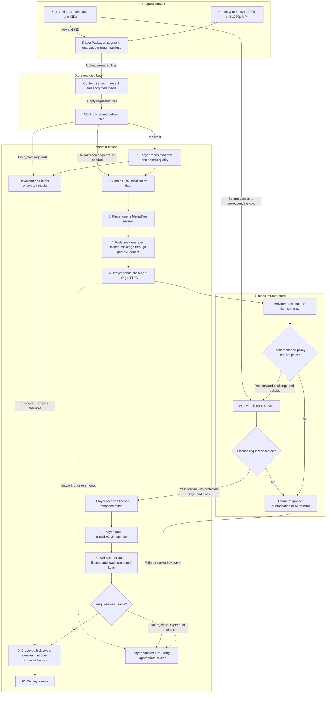

# DRM and Widevine Complete Ecosystem

Example: one movie, already encoded as unencrypted 720p and 1080p MP4 files.

This reference covers content preparation, encryption, delivery, license exchange, and the Android player’s responsibilities. Detailed native Widevine implementation, secure key loading, and TEE internals are reserved for a separate study session.

Examples describe a generic streaming service, not Amazon Prime Video’s actual internal architecture. Names under example.com and all key values are fictional.

## Contents

1. DRM and Widevine
2. Complete ecosystem diagram
3. Each component and its owner
4. Content ID, KID, content key, PSSH, and IV
5. Preparing the movie
6. Sample manifest and output files
7. Selecting and downloading media
8. License exchange: request and response examples
9. Numbered Android sequence
10. Failure cases
11. Widevine security levels
12. License services available in the market
13. Packaging tools and related software
14. Common misconceptions and final recap
15. Sources

## 1. DRM and Widevine

**DRM = Digital Rights Management.** In streaming media, it combines encryption, controlled key delivery, usage policies, and playback protection.

Encryption makes compressed media unreadable without the appropriate key. A DRM license gives an authorized DRM client protected access to that key and defines applicable conditions. A license is more than an approval flag.

**Widevine is Google’s DRM system.** It includes client and server technology. It is not a codec, container, manifest format, CDN, or video decoder.

Other major media DRM systems include **Microsoft PlayReady** and **Apple FairPlay Streaming**. A service may use multiple DRM systems to support different platforms. Where packaging and encryption schemes are compatible, different DRM systems can protect access to the same encrypted media; every platform does not necessarily require a separate video encode. [S1, S16, S17, S18]

Do not confuse this DRM with **Linux DRM: Direct Rendering Manager**, the kernel graphics subsystem used in display/GPU stacks.

### Compression, encryption, and decoding

| Operation | Purpose | Example |
|---|---|---|
| Encoding/compression | Represent video using fewer bits | H.264, HEVC, AV1 |
| Packaging | Organize encoded tracks for delivery | DASH/HLS packaging, fragmented MP4 |
| Encryption | Protect compressed samples using a secret key | AES-based Common Encryption |
| Decryption | Recover compressed samples | Device DRM crypto path |
| Decoding | Reconstruct frames from compressed samples | MediaCodec and selected decoder |
| Display | Present decoded frames | Output Surface and Android display pipeline |

Encryption does not change H.264 into another codec. An encrypted H.264 stream still needs an H.264 decoder after decryption.

## 2. Complete ecosystem diagram

This preserves the agreed diagram and numbered device sequence. Arrows show logical data/control flow, not exact Android process boundaries.



### How to read the diagram

- Media preparation happens before playback for this video-on-demand example.
- Key service and license service can belong to the same provider. Their connecting arrow means secure availability of the corresponding keys, not necessarily a new key-service call for every license.
- Step 2 can use initialization data from the manifest or an initialization segment.
- Downloading encrypted media can overlap with steps 3–8.
- Step 9 requires **both buffered encrypted samples and a usable key**.
- A pending key can mean waiting or renewal, rather than immediate terminal failure. The diagram condenses that handling into the player’s error/recovery path.
- An offline license can be restored instead of acquiring a new online license.
- If device provisioning is needed, an additional provisioning exchange occurs; it is outside the main path.
- Step 10 deliberately summarizes the graphics/display path.

## 3. Each component and its owner

These are software responsibilities, not a requirement for separate companies or physical servers.

| Component | Input | Output / job | Typical operator |
|---|---|---|---|
| Content owner | Original production asset | Supplies movie and protection requirements | Studio/distributor |
| Source storage | Original or encoded files | Private input storage for processing | Studio, streaming provider, or cloud infrastructure |
| Encoder | Source media | 720p/1080p compressed versions | Streaming provider or processing service |
| Packager/encryptor | Encoded tracks, keys, configuration | Manifest, init segments, encrypted samples | Streaming provider or managed packaging service |
| Key service | Authorized packaging/key requests | Content keys, KIDs, related metadata | DRM vendor or provider’s own backend |
| Content Server/origin | Prepared outputs | Stores/serves manifest and media files | Streaming provider, hosted storage, or origin service |
| CDN | Origin files and viewer requests | Distributed caching and delivery | CDN company or provider’s own network |
| Account/entitlement backend | User token, asset, account state | Permission and business-policy decisions | Streaming provider |
| License proxy | DRM challenge and authorization context | Validated request plus policy; response relay | Streaming provider or contracted DRM service |
| DRM license service | DRM request, corresponding keys, policy | Device-specific license response | DRM vendor or authorized service operator |
| Player | Playback configuration and downloaded data | Quality selection, buffering, request transport | Application/player library |
| Device DRM implementation | Initialization data and license | DRM messages, key state, permitted crypto use | Device-integrated DRM vendor/OEM components |

For example, **Amazon S3** can hold origin files and **Amazon CloudFront** can deliver them. The content provider manages its assets and access configuration; AWS operates that infrastructure. S3 itself does not automatically package or DRM-encrypt uploaded MP4 files. [S9, S10]

A CDN reduces origin load and improves delivery at scale. On a cache miss it fetches from the origin; on a cache hit it serves a cached copy. The CDN does not need the media content key to serve encrypted files. A small deployment can serve directly from an origin without a CDN. [S10]

## 4. Content ID, KID, content key, PSSH, and IV

| Term | Meaning | Secret? | Where it can appear |
|---|---|---|---|
| Content ID / movie ID | Application/provider identifier for an asset | Usually no | Backend catalog, packaging configuration, URLs, possibly DRM metadata |
| KID: Key ID | Identifier naming a content encryption key | No | Manifest and media encryption metadata; DRM exchanges |
| Content key | Symmetric key used for encryption/decryption | **Yes** | Secure backend/key-management and device DRM internals |
| PSSH | Protection System Specific Header: DRM initialization data | Generally not secret | DASH manifest and/or MP4 initialization data |
| IV | Initialization Vector used by the encryption scheme | Normally not secret | Sample or track encryption metadata, depending on scheme |
| DRM system UUID | Fixed identifier naming a DRM system | No | ContentProtection and PSSH signaling |
| DRM session ID | Local handle identifying a DRM session | Not a content key | App-to-DRM operations |

Example:

```text
Content ID: MOVIE_123
KID:        11223344-5566-7788-9900-aabbccddeeff
AES key:    9f0c7a2d4b8e6135a6d902cf107be458
```

The illustrated AES-128 key is 16 bytes represented by 32 hexadecimal characters. Hex and Base64 are encodings, not cryptographic protection.

**KID is not a public key.** The content key is a symmetric secret key, not an asymmetric “private key.” Knowing the KID does not reveal the key.

The key service commonly assigns the KID with the key; some integrations accept a caller-supplied KID. Packaging and licensing must agree on the association. [S3, S14]

### Does every movie or segment have a different key?

| Strategy | Example |
|---|---|
| One key per title | Both video qualities share one key |
| Separate keys by track/group | Audio, 720p, and 1080p can use separate keys |
| Key rotation | Key changes at configured time intervals |
| Per-segment keys | Possible with an appropriate design; not mandatory |

For our simplest example, every video segment of MOVIE_123 shares Key A. Another movie uses Key B. Segments sharing a key can use different IV/encryption metadata. One movie may instead have multiple KIDs.

## 5. Preparing the movie

1. Start with movie-720.mp4 and movie-1080.mp4.
2. Ensure their timelines and suitable random-access/keyframe boundaries align for switching.
3. Configure packaging format, segment duration, encryption scheme, and DRM signaling.
4. Obtain content keys and KIDs through an authenticated backend integration.
5. Package and encrypt compressed media samples.
6. Generate initialization segments and manifest.
7. Upload prepared outputs to the origin.
8. Configure CDN delivery and the playback licensing integration.

Shaka supports key-server integration and explicitly supplied raw keys. Supplying a raw key or generating Widevine signaling does **not** create a working license service automatically. Licensing must be configured to issue the matching key material. [S2, S3]

Encryption and segmentation can occur in one packaging operation. MP4 headers and selected sample bytes may remain clear, depending on the scheme. DRM encryption does not necessarily encrypt every byte of a segment.

For a four-second segment at approximately 5 Mbps:

```text
4 seconds × 5 megabits/second = 20 megabits ≈ 2.5 MB
```

This is an average estimate, excluding other tracks/overhead. A segment contains many compressed samples; it is not a single decoded frame.

## 6. Sample manifest and output files

### Example files

| File pattern | Purpose |
|---|---|
| movie123/manifest.mpd | DASH presentation description |
| movie123/720/init.mp4 | Initialization for 720p video |
| movie123/720/seg-1.m4s, seg-2.m4s, ... | Encrypted 720p samples |
| movie123/1080/init.mp4 | Initialization for 1080p video |
| movie123/1080/seg-1.m4s, seg-2.m4s, ... | Encrypted 1080p samples |
| movie123/audio/... | Separately packaged audio, when configured |

### Illustrative DASH MPD

This is a video-only educational example for a 60-second asset. It is not a ready-to-play asset: matching media files and valid Widevine initialization data must exist. PSSH is assumed to be supplied by the initialization segments. The application configures the license URL separately.

```xml
<?xml version="1.0" encoding="UTF-8"?>
<MPD xmlns="urn:mpeg:dash:schema:mpd:2011"
     xmlns:cenc="urn:mpeg:cenc:2013"
     profiles="urn:mpeg:dash:profile:isoff-live:2011"
     type="static"
     mediaPresentationDuration="PT60S"
     minBufferTime="PT2S">

  <Period id="p0" start="PT0S">
    <AdaptationSet id="1"
                   contentType="video"
                   mimeType="video/mp4"
                   codecs="avc1.640028"
                   segmentAlignment="true">

      <ContentProtection
          schemeIdUri="urn:mpeg:dash:mp4protection:2011"
          value="cenc"
          cenc:default_KID="11223344-5566-7788-9900-aabbccddeeff"/>

      <ContentProtection
          schemeIdUri="urn:uuid:edef8ba9-79d6-4ace-a3c8-27dcd51d21ed"
          value="Widevine"/>

      <Representation id="720p"
                      bandwidth="2500000"
                      width="1280"
                      height="720"
                      frameRate="30">
        <SegmentTemplate timescale="1"
                         duration="4"
                         startNumber="1"
                         initialization="720/init.mp4"
                         media="720/seg-$Number$.m4s"/>
      </Representation>

      <Representation id="1080p"
                      bandwidth="5000000"
                      width="1920"
                      height="1080"
                      frameRate="30">
        <SegmentTemplate timescale="1"
                         duration="4"
                         startNumber="1"
                         initialization="1080/init.mp4"
                         media="1080/seg-$Number$.m4s"/>
      </Representation>

    </AdaptationSet>
  </Period>
</MPD>
```

### What the player learns

| Field | Meaning |
|---|---|
| mimeType | Container/media type; not proof of DRM |
| codecs | Codec identification |
| Representation | One encoded option |
| bandwidth | Declared representation bandwidth, not a measurement of the viewer’s connection |
| width / height | Encoded dimensions |
| SegmentTemplate | Initialization/media URL construction |
| ContentProtection | Protection signaling |
| cenc:default_KID | Default content-key identifier |
| edef8ba9-79d6-4ace-a3c8-27dcd51d21ed | Fixed Widevine system UUID |

The content ID is not required as a dedicated movie-ID field. The secret key is not published in the MPD. Protection metadata also exists in the media. [S4]

## 7. Selecting and downloading media

The player reads the manifest and selects a representation using bandwidth estimates, buffer state, decoder capability, application choices, and applicable restrictions.

It requests bytes using the selected segment URLs, for example:

```http
GET /movie123/720/init.mp4 HTTP/1.1
Host: cdn.example.com
```

Then it requests 720p media segments. It can switch to corresponding 1080p segments at suitable boundaries. The origin/CDN normally serves what is requested; it does not need to measure the viewer’s bandwidth and invent a new stream URL.

Encrypted bytes can be downloaded and buffered without a usable content key. Decrypting them requires the appropriate usable key.

### How does the player discover the license URL?

**Not from the KID.** The application supplies the URL through playback configuration, or a supported manifest mechanism signals it.

Illustrative backend configuration:

```json
{
  "contentId": "MOVIE_123",
  "manifestUrl": "https://cdn.example.com/movie123/manifest.mpd",
  "drmSystem": "widevine",
  "licenseUrl": "https://license.example.com/widevine"
}
```

These are application-defined fields, not a standardized DRM API response.

Shaka Player browser configuration:

```javascript
player.configure({
  drm: {
    servers: {
      "com.widevine.alpha":
        "https://license.example.com/widevine"
    }
  }
});
```

Shaka Player is the playback library; Shaka Packager prepares media. In supported DASH players, license acquisition URLs can also be signaled in the MPD, for example using dashif:Laurl. [S7, S8]

## 8. License exchange: request and response examples

### Two different endpoints

| Endpoint | Caller | Purpose |
|---|---|---|
| Packaging-key endpoint | Authorized packager/backend | Obtain keys for encryption |
| Playback-license endpoint | Player transporting device DRM messages | Obtain license for decryption |

The same provider can operate both. They are not interchangeable APIs.

### Request: conceptual contents

The device DRM implementation constructs a protocol-specific challenge using initialization data and its DRM client context.

Conceptually, it carries content/key references, request type, client-related information, request identifiers, and cryptographic information. Not every request lists KIDs as a plain array; the content reference can instead be carried through DRM-specific initialization data.

**The following JSON is an explanatory model with invented fields. It is NOT the actual Widevine binary schema or a request that can be sent to a real license server.**

```json
{
  "request_type": "STREAMING_LICENSE",
  "content_reference": "<DRM-specific content identification>",
  "requested_key_ids": [
    "11223344-5566-7788-9900-aabbccddeeff"
  ],
  "client_information": "<DRM client information>",
  "request_id": "<request identifier>",
  "cryptographic_data": "<protocol-specific bytes>"
}
```

Illustrative HTTP transport:

```http
POST /widevine HTTP/1.1
Host: license.example.com
Authorization: Bearer <playback-authorization-token>
Content-Type: application/octet-stream

<binary license challenge generated through MediaDrm>
```

Authorization headers/wrappers are service-specific. The player does not normally invent the internal Widevine challenge fields.

### Successful response: conceptual contents

**Again: invented explanatory JSON, not actual Widevine wire-format JSON.**

```json
{
  "license_id": "<license identifier>",
  "keys": [
    {
      "kid": "11223344-5566-7788-9900-aabbccddeeff",
      "protected_content_key": "<cryptographically protected key material>"
    }
  ],
  "policy": {
    "playback_allowed": true,
    "license_duration_seconds": 86400,
    "playback_duration_seconds": 7200,
    "required_protection": "<required security and output conditions>"
  },
  "cryptographic_data": "<protocol binding and authenticity information>"
}
```

A license can contain multiple keys and applicable policies. Example durations do not define real Widevine field semantics or a real service’s rental rules. [S14]

Illustrative HTTP response:

```http
HTTP/1.1 200 OK
Content-Type: application/octet-stream

<binary DRM license response>
```

Some services wrap binary messages in JSON/Base64. The player removes any service-specific wrapper before passing the appropriate DRM response bytes onward. Base64 alone does not protect keys.

**The server provides the key in protected form, not merely “KID valid: true.”** The application normally cannot read the underlying content key. HTTPS protects transport; DRM additionally protects key delivery/use for the client.

### Who understands the response?

| Layer/component | Responsibility |
|---|---|
| HTTP/network library | Transfer response bytes and HTTP metadata |
| Player | Handle status/wrappers and pass license bytes onward |
| MediaDrm framework | Route DRM operations |
| Widevine implementation | Interpret/validate license and manage protected keys and rules |

The response is not interpreted only by the app/network layer. Its DRM payload is processed by Widevine behind the Android API. [S5, S6]

## 9. Numbered Android sequence

This is the conceptual online streaming path. A player library such as ExoPlayer generally coordinates these APIs rather than requiring application code to implement every step directly.

| Step | Component and action | Result |
|---|---|---|
| 1 | Player parses manifest and selects initial quality | Knows track choices and protection |
| 2 | Player obtains DRM initialization data | Input for license acquisition |
| 3 | Player calls MediaDrm.openSession | DRM session ID |
| 4 | Player calls getKeyRequest; Widevine generates challenge | Opaque request bytes |
| 5 | Player networking sends HTTPS request | Request reaches configured endpoint |
| 6 | Player receives license response | Opaque response bytes, if successful |
| 7 | Player calls provideKeyResponse with session ID | Response delivered to DRM implementation |
| 8 | Widevine processes license and protected keys | Key status becomes usable if permitted |
| 9 | MediaCrypto-associated codec path processes encrypted samples | Decryption followed by decoding |
| 10 | Output frames proceed to display | Visible video |

For streaming, provideKeyResponse does not return the plaintext content key. A DRM session ID is a handle, not a key. MediaDrm does not select quality or download media. [S5]

MediaCrypto associates codec cryptographic operations with a MediaDrm session. The encrypted-sample metadata selects the relevant loaded key using its KID; it also supplies IV and clear/encrypted byte information. [S19]

The exact ordering of session/codec preparation and media downloading varies. Internal proprietary license validation, key unwrapping, secure storage, OEMCrypto, and TEE calls are outside this reference.

## 10. Failure cases

| Failure | Where it is detected | Typical handling |
|---|---|---|
| Subscription/rental not valid | Provider entitlement backend | Deny playback; resolve entitlement |
| Missing/expired authorization token | Proxy/backend | Refresh authorization when appropriate |
| Malformed or unacceptable DRM challenge | License system | Reject and report DRM error |
| Requested keys unavailable | Backend/license system | Correct key mapping/configuration |
| Required security unsupported | License system and/or client enforcement | Deny restricted key; lower permitted track may be possible |
| License response invalid/rejected | Device DRM processing | DRM error; investigate cause |
| Key expired | Device DRM key state | Renew if permitted |
| Output protection insufficient | Device DRM/output path | Restrict playback until requirements are met |
| Network timeout/transient failure | Player networking | Bounded retry when appropriate |
| Segment unavailable | CDN/origin/player | Media-download recovery/error |
| Wrong key associated with KID | Packaging/licensing mismatch | Fix provider configuration; decoding/decryption output fails |

Illustrative application-level denial, **not a Widevine protocol response**:

```http
HTTP/1.1 403 Forbidden
Content-Type: application/json

{
  "error": "PLAYBACK_NOT_AUTHORIZED",
  "message": "No active entitlement for this asset"
}
```

An HTTP error can be handled before calling MediaDrm. A DRM-specific rejection embedded in response bytes can be detected during DRM processing. HTTP 200 alone does not guarantee usable keys.

The KID is a lookup identifier, not proof that the AES key is correct. Encryption modes such as AES-CTR do not inherently authenticate plaintext correctness; incorrect provider key mappings can produce unusable media.

## 11. Widevine security levels

These levels describe Widevine protection capability, not video resolution.

| Level | Broad protection model |
|---|---|
| **L1** | Hardware-backed trusted protection for cryptographic operations and video processing |
| **L2** | Cryptographic operations protected in a trusted environment; video processing outside that environment |
| **L3** | Software-based DRM protection without the L1/L2 trusted execution protection model |

L3 does not mean the decoder must run on the CPU. DRM protection level and hardware video-decoder use are different concepts. [S20]

The device has capabilities; the provider sets minimum requirements for keys. A license cannot upgrade an L3 device into L1.

Illustrative policy:

| Quality | Content key | Requirement |
|---|---|---|
| 720p | A | L3 or stronger permitted |
| 1080p | B | L1 required |

This is a fictional policy, not an industry-wide resolution rule. Different key groups allow different protection policies. A high-speed connection does not override them. L1 also does not guarantee 4K: entitlement, codecs, display/output protection, device approval, and service policy can further limit playback. Actual licenses express requirements through protocol-defined fields, not necessarily literal strings “L1/L2/L3.” [S15]

## 12. License services available in the market

Representative examples verified against official documentation/provider listings on 20 October 2026. This is not an exhaustive ranking; offerings and contracts differ.

| Provider / offering | Role |
|---|---|
| **Google Widevine Cloud License Service** | Widevine cloud key/license infrastructure |
| **Widevine License Server SDK** | Technology for an authorized operator to host its own service |
| **Axinom DRM** | Hosted multi-DRM/key and license services |
| **BuyDRM** | Commercial DRM/license-service provider |
| **castLabs** | Commercial DRM/license-service provider |
| **EZDRM** | Hosted DRM/license services |
| **DoveRunner** | Commercial DRM/license-service provider |
| **ExpressPlay** | Commercial DRM/license-service provider |
| **Irdeto** | Content-protection/license-service provider |
| **NAGRA** | Content-protection/license-service provider |
| **Verimatrix** | Content-protection/license-service provider |
| **Viaccess-Orca** | Content-protection/license-service provider |

The commercial names above appear in Widevine’s third-party provider list. Listing is not a guarantee of a particular feature, SLA, price, or packaging API. Confirm which DRM systems, key integration, offline policies, and device support are included. [S11]

**PlayReady and FairPlay are DRM technologies, not names for a single universal license endpoint.** A streaming provider chooses an implementation/operator and supplies the correct endpoint to its player.

In Google’s documented cloud path, partner proxy validation precedes license fulfillment; the app does not simply contact an arbitrary global key lookup service using a public KID. [S1]

## 13. Packaging tools and related software

| Tool / service | Type | Relevant job | Distinction |
|---|---|---|---|
| **Shaka Packager** | Packaging tool/SDK | DASH/HLS, fragmentation, encryption, DRM signaling/key integrations | Not a license server or video transcoder |
| **FFmpeg** | Media processing toolkit | Encoding/transcoding, muxing, DASH/HLS output, supported encryption workflows | Encryption flags alone do not create a full Widevine licensing service |
| **Bento4** | MP4 toolkit | Fragmentation, DASH/HLS packaging, Common Encryption and DRM signaling | Includes tools such as mp4fragment, mp4encrypt, mp4dash |
| **GPAC / MP4Box** | Multimedia framework/tools | DASH packaging and Common Encryption workflows | GPAC encryption filters and XML configuration support protected packaging |
| **AWS Elemental MediaPackage** | Managed service | Packaging/origin functionality and content protection integrations | Check supported input/workflow; not an assumption of direct arbitrary MP4 upload |
| **Shaka Player** | Browser player library | Playback, adaptive quality, DRM integration | Consumes media; does not prepare the origin library |
| **Android Media3 ExoPlayer** | Android player library | Media playback and MediaDrm integration | Not a packager or license server |

Sources: Shaka [S2, S3]; FFmpeg [S12]; Bento4 [S13]; GPAC [S21]; MediaPackage [S22]; players [S7, S23].

For the two pre-encoded MP4 files, a straightforward division is: **Shaka Packager prepares protected media; origin/CDN delivers it; contracted licensing issues licenses; ExoPlayer or Shaka Player handles playback.** This is an architecture example, not a complete production deployment recipe.

## 14. Common misconceptions and final recap

| Misconception | Correct understanding |
|---|---|
| H.264 encrypts the movie | H.264 compresses video |
| KID is a public cryptographic key | It is an identifier |
| Each segment automatically needs a new key | Key strategy is configured independently |
| Manifest contains the readable secret key | It contains identifiers/signaling, not the usable secret |
| KID tells the browser which server to contact | License URL is configured or signaled separately |
| MediaDrm downloads the license itself | It generates/processes DRM messages; player networking transports them |
| License response only approves a KID | It includes protected key material and policy |
| HTTP 200 guarantees playback | DRM processing and key/output conditions must also succeed |
| CDN decrypts video before sending it | It can deliver the encrypted bytes unchanged |
| L1 means 1080p/4K | It describes protection capability, not a fixed resolution |
| Internet is needed for AES itself | Remote service access requires networking; local encryption/decryption does not |
| Downloading encrypted bytes requires the content key | Using those encrypted samples requires the key |
| Every playback must obtain a fresh online license | Valid existing/offline licenses may be reusable |

### Final sequence

**Prepare:** encoded MP4 files → obtain key/KID → package and encrypt → upload manifest and media.

**Deliver:** player obtains playback configuration → downloads manifest → selects permitted quality → buffers encrypted samples.

**License:** device DRM generates challenge → player sends it → backend authorizes → license service returns protected keys and rules → player passes response to DRM.

**Play:** required key becomes usable internally → decrypt compressed samples → decode frames → display.

**The next study topic is what happens inside Android’s DRM/native Widevine implementation when the player calls provideKeyResponse.**

## 15. Sources

Links are primary documentation unless marked as research. Provider/tool availability was checked on 20 October 2026. Examples in this reference are original explanatory examples.

- [S1: Google — Widevine overview, key retrieval, license infrastructure and proxy](https://developers.google.com/widevine/drm/overview)
- [S2: Shaka Packager — Widevine key-server integration](https://shaka-project.github.io/shaka-packager/html/tutorials/widevine.html)
- [S3: Shaka Packager — Raw key encryption and key identifiers](https://shaka-project.github.io/shaka-packager/html/tutorials/raw_key.html)
- [S4: DASH-IF — CPIX and content-protection metadata](https://dashif.org/CPIX/)
- [S5: Android — MediaDrm API](https://developer.android.com/reference/android/media/MediaDrm)
- [S6: AOSP — DRM framework and plugins](https://source.android.com/docs/core/media/drm)
- [S7: Shaka Player — DRM configuration](https://shaka-project.github.io/shaka-player/docs/api/tutorial-drm-config.html)
- [S8: DASH-IF dash.js — DRM and license URL configuration](https://dashif.org/dash.js/pages/usage/drm.html)
- [S9: AWS — S3 and CloudFront video delivery example](https://docs.aws.amazon.com/AmazonS3/latest/userguide/tutorial-s3-cloudfront-route53-video-streaming.html)
- [S10: AWS — How CloudFront delivers content](https://docs.aws.amazon.com/AmazonCloudFront/latest/DeveloperGuide/HowCloudFrontWorks.html)
- [S11: Widevine — Third-party license-service providers](https://developer.widevine.com/solutions/widevine-providers)
- [S12: FFmpeg — Formats, DASH/HLS and encryption options](https://ffmpeg.org/ffmpeg-formats.html)
- [S13: Bento4 — mp4dash packaging and encryption options](https://www.bento4.com/documentation/mp4dash/)
- [S14: Axinom — Asset protection, license contents and KIDs](https://docs.axinom.com/services/drm/general/faq/faq-asset-protection)
- [S15: Axinom — Per-key Widevine security policies](https://docs.axinom.com/services/drm/general/faq/faq-security)
- [S16: Microsoft — PlayReady](https://learn.microsoft.com/en-nz/playready/)
- [S17: Apple — FairPlay Streaming](https://developer.apple.com/streaming/fps/)
- [S18: Shaka Packager — DRM integrations](https://shaka-project.github.io/shaka-packager/html/tutorials/drm.html)
- [S19: Android — MediaCrypto session association and key selection](https://developer.android.com/reference/android/media/MediaCrypto)
- [S20: Patat, Sabt and Fouque — Exploring Widevine for Fun and Profit, research](https://arxiv.org/abs/2204.09298)
- [S21: GPAC — Common Encryption](https://wiki.gpac.io/xmlformats/Common-Encryption/)
- [S22: AWS — MediaPackage overview](https://docs.aws.amazon.com/mediapackage/latest/userguide/what-is.html)
- [S23: Android — ExoPlayer DRM support](https://developer.android.com/media/media3/exoplayer/drm)
- [S24: Shaka Packager — DASH output arrangements](https://shaka-project.github.io/shaka-packager/html/tutorials/dash.html)

