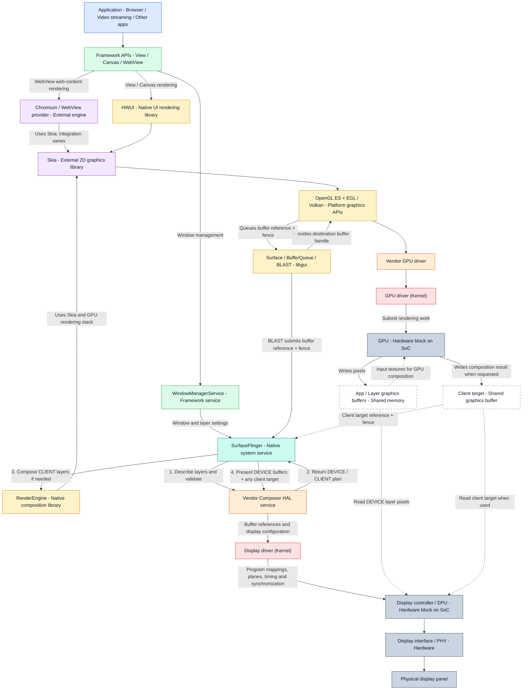

# Android Graphics Architecture: Application to Physical Display

A component reference for Android graphics, with an diagram, process/thread placement, buffer ownership, synchronization, composition examples and source paths.

## 1. Scope and reading rules

This page follows a hardware-accelerated View-based application through app rendering, buffer submission, SurfaceFlinger composition and physical display output. Browser, WebView, video, native graphics and automotive virtualization have additional paths explained below.

The main distinction is between **rendering a window's contents**, **composing existing window/layer buffers**, and **presenting pixels through display hardware**. These are separate jobs.

The diagram is a component map, not a strict call stack or a timing trace. Libraries execute inside their host processes. A GPU node is shared hardware, not a process. Shared library/engine nodes represent functionality reused by different processes, not one singleton instance. Native graphics code does not execute through ART as a mandatory forwarding stage.

## 2. Final component diagram



| Colour | Category |
|---|---|
| Blue | Application |
| Green | Framework API/service |
| Teal | Native system service |
| Yellow | Android native library/API implementation |
| Purple | External engine/library integrated with Android |
| Orange | Vendor driver/HAL implementation |
| Red | Kernel driver |
| Grey | Hardware |
| White with dashed border | Buffer memory |

### Diagram qualifications

- View, Canvas and WebView are grouped by framework category; they are not interchangeable APIs or necessarily delivered in one binary.
- WebView is integrated into the View/HWUI pipeline. Its Chromium branch is not a completely independent parallel path. Chrome is also not simply an application containing a WebView: it has its own Chromium architecture.
- Video decoder output can bypass app HWUI rendering. Not every pixel from a streaming app is rendered by Skia.
- The BufferQueue arrow back to the graphics APIs represents allocation/ownership and submission. The kernel GPU driver does not push a finished frame into BufferQueue.
- Buffer A already exists before GPU rendering into A. The GPU writes to it directly.
- RenderEngine's GPU work writes the client target, whereas app GPU work writes app buffers. Sharing a GPU node does not mean the same commands write both destinations.
- Composition validation normally precedes CLIENT rendering. Android may reuse a valid plan or use optimized presentation paths; the numbered arrows explain the logical dependency, not a compulsory full negotiation on every frame.
- The diagram describes a physical Android display path. A virtualized automotive platform can insert a guest/host display path.

## 3. Component, layer, process and thread reference

| Component | Architectural placement | Typical execution location | Main responsibility |
|---|---|---|---|
| Application / Activity | Application | App main/UI thread plus application-specific threads | Construct UI and request rendering |
| View / Canvas / WebView | Framework APIs | App process; View work primarily UI thread | Public drawing/UI entry points |
| WindowManagerService | Framework system service | system_server; Binder and service handler threads | Window policy, layout, visibility and ordering |
| HWUI | Native libraries | App process; UI-thread recording and RenderThread rendering infrastructure | Render Android UI using render nodes and Skia |
| Chromium / WebView provider | External engine/provider | Host/provider code and renderer processes; configuration-dependent | HTML/CSS layout, web rendering and web composition |
| Skia | Native libraries; externally maintained project | Calling process/thread; often RenderThread for HWUI | Implement 2D drawing through CPU/GPU backends |
| EGL / GLES / Vulkan platform libraries | Native libraries | Calling app/service process | Graphics API entry points, context/surface support and dispatch/loading |
| Vendor GPU driver | Vendor native implementation | Calling app/service process, potentially helper threads | Prepare GPU work and resources |
| GPU kernel driver | Kernel | Kernel execution, interrupt/workqueue/firmware interactions | Device mappings, submission, scheduling coordination and completion |
| GPU | Hardware | Hardware queues/engines | Execute graphics work and write image buffers |
| Surface / BufferQueue / BLAST | Native libraries, libgui | Host process; thread/callback/Binder placement varies | Buffer ownership, submission and transactions |
| SurfaceFlinger | Native system service | surfaceflinger process; main composition, scheduling and Binder threads | Manage layers and coordinate display composition |
| RenderEngine | Native libraries | SurfaceFlinger process; may use its rendering worker | GPU composition of selected layers |
| Vendor Composer HAL | HAL | Vendor composer service; Binder and implementation workers | Validate composition plans and coordinate presentation |
| Display kernel driver | Kernel | Kernel callbacks, interrupts and workers | Program display hardware and synchronize scanout |
| DPU / display controller | Hardware | Hardware fetch/mixer/timing blocks | Read buffers and generate display output |
| Display interface / PHY | Hardware | Link/transmitter hardware | Transport display output over DSI/DP/etc. |
| Panel | Hardware | Panel electronics | Convert incoming display information into visible light |

A library does not have a mandatory dedicated thread just because it has a component name. In particular, there is no universal Skia thread or BufferQueue thread. Actual names and scheduling should be confirmed with traces for the target build.

## 4. Application and framework

### Application

A normal Activity builds a View hierarchy. Buttons, labels and images usually become drawing content of a window; each View is not automatically a separate SurfaceFlinger layer. App-created SurfaceViews, additional windows and system UI can introduce separate layers.

### View and Canvas

View traversal performs measurement, layout and drawing. In a hardware-accelerated window, drawing is commonly recorded into RenderNode content rather than immediately calculating every pixel on the UI thread. Canvas supplies operations such as drawRect, drawPath and drawText. A bitmap-backed Canvas can instead use software rasterization.

### Supporting framework components

| Component | Job |
|---|---|
| Choreographer | Schedules frame callbacks aligned with display timing information |
| ViewRootImpl | Coordinates root View traversal and window/surface interaction |
| RenderNode | Stores renderable UI content and rendering properties |
| ThreadedRenderer / HardwareRenderer | Framework bridge into native rendering infrastructure |
| JNI | Bridge between managed framework code and native implementations |
| ART | Executes managed app/framework code; not a separate hop carrying buffers to the GPU |

### WindowManagerService

WMS manages window state, layout and policy and coordinates surface/layer state through SurfaceControl and related infrastructure. It does not rasterize your View tree. Window-control transactions and pixel-buffer production are related but different flows.

## 5. HWUI, Skia and Chromium

### HWUI

HWUI is Android's native hardware-accelerated UI rendering implementation, principally under frameworks/base/libs/hwui/. It processes RenderNode content, rendering properties, animations and frame rendering. A normal app accesses it through supported framework APIs rather than linking directly to private libhwui interfaces.

The source sits under frameworks/base, but its C++ implementation belongs in the native-library portion of the architecture. Source ownership, directory location and architectural layer are different classifications.

### Skia

Skia is a cross-platform C++ 2D graphics engine imported into AOSP under external/skia/. It implements geometry drawing, image sampling, clipping, transformations, paint effects, anti-aliasing and blending. Text drawing integrates with other font/text infrastructure; Skia alone is not the complete Android text-layout system.

A backend is code implementing drawing through a particular mechanism. Skia can rasterize using the CPU or generate graphics work using a supported GPU backend. In the discussed paths, OpenGL ES and Vulkan are alternatives. The vendor driver still performs hardware-specific compilation and command preparation: Skia does not directly program GPU registers.

HWUI uses Skia instead of maintaining an entirely separate implementation of all 2D primitives and effects. Older Android HWUI implementations had a direct GL renderer; this page describes the modern Skia-based model.

### Chromium / WebView

WebView exposes an Android framework API while an installed WebView provider supplies Chromium-based implementation code. Chromium handles web content parsing/layout, paint and compositing machinery. Its rendering uses Skia but also includes components such as Blink and compositor infrastructure; it is not just a thin call from WebView to Skia.

Hardware-accelerated WebView drawing integrates with the embedding app's Android rendering machinery. Chromium can use multiple processes and threads. A Chrome browser has a distinct browser/renderer/compositor architecture; do not infer that every browser calls android.webkit.WebView.

## 6. EGL, OpenGL ES, Vulkan and GPU drivers

OpenGL ES and Vulkan are Khronos API standards. Android supplies integration, loader/dispatch libraries; GPU vendors supply device-specific implementations. They are not upstream drawing libraries equivalent to Skia, and their Android integration need not reside in external/.

| Component | Job | Examples |
|---|---|---|
| EGL | Context and window-surface management for the GLES path | eglCreateContext, eglMakeCurrent, eglSwapBuffers |
| OpenGL ES | Programmable graphics operations | glUseProgram, glBindTexture, glDrawArrays |
| Vulkan | Explicit resources, pipelines, command buffers, submission and presentation | vkCreateGraphicsPipelines, vkQueueSubmit, vkQueuePresentKHR |

GLES 1.x uses a legacy fixed-function model. GLES 2.0 introduces programmable shaders; GLES 3.x extends that model. Android GLES2 source machinery serves newer API generations too. Vulkan normally uses its own WSI/swapchain presentation path rather than EGL. Vulkan is not automatically faster; workload, implementation and driver quality matter.

Android 15 supports both discussed HWUI backends. Do not assume a backend solely from OS version. HWUI's renderer selection and SurfaceFlinger's RenderEngine selection are separate configurations; they need not choose the same API.

The vendor GPU driver prepares commands/resources in the calling process. The kernel GPU driver establishes device access to allocations, coordinates submission and scheduling with hardware/firmware, and reports completion. The GPU executes work and writes pixels. Neither driver is the DPU.

## 7. Buffers: where the pixels actually live

The GPU does not first create a whole image elsewhere and then push it into BufferQueue. It is instructed to render into an already allocated destination graphics allocation.

| Term | Meaning |
|---|---|
| Surface | Producer-facing buffer submission interface |
| GraphicBuffer | Android object describing/referencing a graphics allocation |
| AHardwareBuffer | Public native API representation of a hardware buffer |
| Native handle | File descriptors and vendor-defined information referencing an allocation |
| DMA-BUF | Linux sharing mechanism for allocations across processes/drivers/devices |
| BufferQueue slot | Bookkeeping entry for an allocation and its ownership |
| EGL window buffer / Vulkan image | Graphics API representation used as a rendering destination |
| Client target | GPU-composed CLIENT layers supplied for display presentation |

These objects do not imply extra full-image copies. Typical Android hardware uses DMA-BUF-backed graphics allocations, but handle layouts and backing details are vendor-specific.

A format such as RGBA_8888 specifies four 8-bit components per pixel logically. RGBX_8888 has an unused component; RGBA_FP16 uses half-float components. Video often uses YUV formats. These are buffer formats, not PNG/JPEG files. Allocation layout can be tiled, padded or compressed, with extra metadata. Therefore width × height × 4 is a logical RGBA payload calculation, not a guaranteed allocation-size formula.

### Sharing example

Assume allocation A backs the app's window buffer. The app-side handle may contain FD 42, while another process receives FD 87 referring to the same DMA-BUF. FD numbers are process-local. The GPU and DPU can also have different device virtual addresses mapping that same allocation. Neither the FD number nor an app pointer is the hardware address.

Drivers import/map the allocation for the device, often through an IOMMU. The GPU writes it; later the GPU compositor or DPU reads it. Shared memory does not mean unrestricted access: permissions, protected-buffer restrictions and synchronization still apply.

## 8. libgui, BufferQueue, BLAST and buffer lifetime

libgui is Android platform C++ code. It supplies infrastructure such as Surface, SurfaceControl, BufferQueue and BLASTBufferQueue; it does not draw the app's text/buttons. Its private platform interfaces are not general public NDK APIs.

BufferQueueCore tracks slots, queue/configuration state and locking. BufferQueueProducer exposes producer operations; BufferQueueConsumer exposes consumer operations. Execution happens on participating caller/callback/Binder threads, depending on where the endpoints reside.

For a typical modern Activity, BLASTBufferQueue is the immediate consumer of its local BufferQueue and submits acquired buffers to SurfaceFlinger using transactions. Older descriptions showing SurfaceFlinger as the direct BufferQueue consumer simplify this modern arrangement.

| Stage | Operation | Meaning |
|---|---|---|
| FREE | Available slot | Can be dequeued; reuse fence may still constrain writes |
| DEQUEUED | dequeueBuffer | Producer obtains ownership and destination allocation |
| Rendering | Submit graphics work | GPU writes the destination after prior-use synchronization |
| QUEUED | queueBuffer | Producer submits buffer reference, metadata and readiness fence |
| ACQUIRED | acquireBuffer | Consumer obtains ownership and schedules safe consumption |
| Released | releaseBuffer | Buffer becomes reusable subject to release synchronization |

Producer cancellation can return a dequeued buffer without queuing a frame. Queuing can occur before GPU rendering completes; fences make that safe. Allocations normally survive many frames and are reused. Buffer counts vary; triple buffering is not a universal fixed rule. Resizing/reconfiguration/window teardown can retire allocations; outstanding references and device use must finish before memory is reclaimed.

BufferQueue passes handles, not copies of pixel contents. End-to-end rendering can nevertheless require new output buffers: GPU composition writes a client target, for example. Do not call the entire pipeline universally copy-free.

## 9. Fences and timing

A fence represents completion of asynchronous work; it is not image data. Android commonly passes synchronization fences through file descriptors. A buffer FD and a fence FD refer to different things.

| Fence role | Prevents |
|---|---|
| Producer readiness / consumer acquire fence | Consumer reading before rendering has finished |
| Consumer release / producer reuse fence | Producer overwriting memory still being consumed |

A consumer can receive a buffer before its readiness fence signals. Waiting can be arranged in hardware/driver work dependencies rather than by blocking the CPU for every operation. Ownership state and hardware readiness are distinct concepts. VSync is a display timing event, not a replacement for per-buffer fences. Present/release fence semantics are API-specific; they should not be interpreted as a universal timestamp for when every panel pixel becomes visible.

## 10. SurfaceFlinger and RenderEngine

SurfaceFlinger is a native C++ Binder service in its own process. A layer combines state such as bounds, crop, transforms, alpha and order with content when applicable. Some layers are containers or solid colours rather than buffer-bearing images. Z-order is subject to hierarchy and relative ordering, not just a flat application-provided integer list.

SurfaceFlinger selects buffers and coordinates composition using its internal layer/composition/scheduling machinery. CompositionEngine is internal composition infrastructure, not another independent service after SurfaceFlinger. SurfaceFlinger does not CPU-read every pixel and does not always merge every layer into one buffer.

RenderEngine is an Android native library used inside SurfaceFlinger, not a separate service. Its Skia-based implementation imports input images, applies composition drawing requirements and renders selected layers into an output buffer using the GPU. Its output for physical-display CLIENT composition is the client target. RenderEngine can also support other rendering operations, such as capture paths; its existence is broader than one physical-display pass.

HWUI renders View content into an app window buffer. RenderEngine renders existing layer images into a composition output. Both can use Skia, but in different processes and rendering contexts.

## 11. Composer HAL: interface, implementation and order

Android defines the HAL contract; vendors implement it for their display capabilities. Modern Composer uses AIDL android.hardware.graphics.composer3 with IComposer/IComposerClient. Older implementations use HIDL composer versions. AIDL commands can be batched in executeCommands; conceptual setter/validate/present operations are not necessarily separate Binder calls.

Typical logical order:

1. SurfaceFlinger describes relevant layer buffers/state.
2. HWC validates a plan and reports requested composition types/changes.
3. SurfaceFlinger performs required CLIENT composition through RenderEngine.
4. SurfaceFlinger supplies the client target, required DEVICE buffers and fences.
5. HWC coordinates presentation through its display-driver backend and returns synchronization results.

HWC does not directly call SurfaceFlinger's RenderEngine to render. It reports the need for CLIENT composition. Optimizations may skip unchanged validation or reuse content; this is the logical model, not an unconditional full sequence on every refresh.

### Three examples

| Case | Inputs | Result |
|---|---|---|
| DEVICE | Activity A, status bar B, navigation bar C; suitable planes available | DPU reads separate buffers and combines them |
| CLIENT | Layer combination cannot be handled directly | GPU composes designated content into D; DPU scans D |
| Mixed | Video V can use a plane while UI needs GPU composition | DPU combines V with UI client target D |

Reasons for CLIENT requests include unusable/exhausted planes, unsupported format/layout, scaling, transformation, blending/colour restrictions, bandwidth/resource limits and vendor efficiency policy. A protected layer requires a permitted protected path; GPU fallback is not always legal or supported.

HWC plans based on hardware constraints. A software service can control hardware by invoking driver APIs, just as other HAL services configure their devices. It does not normally calculate final blended pixel values on the CPU.

## 12. Display driver, DPU and panel

For a DRM/KMS implementation, vendor HWC can import DMA-BUF allocations, reference them through DRM framebuffer objects, assign framebuffers/properties to planes and issue an atomic commit through ioctl. libdrm may wrap these calls. Vendor backends can use other interfaces; DRM/KMS is not mandated by the Composer interface.

A DRM framebuffer object is a software description referencing image storage, not necessarily a fresh allocation containing a combined screen image. Planes feed a CRTC/display pipeline; connectors describe outputs. Logical DRM objects do not always map one-to-one to named physical blocks.

The display kernel driver manages device access, validates commits and programs addresses, format, stride, crop, placement, blending, timing and synchronization. It does not need to transfer every pixel through a CPU copy. The DPU fetches pixels from shared memory using device-accessible addresses.

The DPU/display controller is a hardware block, usually inside the SoC. It reads planes, performs supported transformations/blending/colour processing, and generates output at the selected timing. Combining layers during scanout need not create a merged image in RAM. A separate interface/transmitter/PHY carries output toward a panel, potentially through bridges or automotive serializer/deserializer links.

DSP and DPU differ: a DSP is a programmable signal processor used for audio and other workloads; a DPU is display-processing hardware. A framebuffer is memory, not either processor.

## 13. One Activity: complete worked example

Assume TestApp shows text and a coloured button in one hardware-accelerated window.

1. Main/UI-thread traversal lays out the Views and records drawing content.
2. HWUI synchronizes render-node state and RenderThread executes frame rendering work.
3. An available window buffer A is obtained through the Surface/graphics integration, waiting for prior-use dependencies as required.
4. Skia and the selected graphics backend prepare drawing work targeting A.
5. Vendor and kernel GPU drivers arrange resources and submit the work; the GPU writes pixels into A.
6. The producer queues A with a readiness fence. This can overlap GPU execution.
7. BLAST acquires the queued buffer and submits it with layer state through a transaction.
8. SurfaceFlinger selects the app buffer along with other visible content.
9. HWC validates the required composition arrangement.
10. If all layers are DEVICE, RenderEngine is bypassed for this composition. Otherwise the GPU renders CLIENT content into client target D.
11. HWC submits the chosen buffers and plane/timing configuration through the display driver.
12. The DPU reads A and other DEVICE buffers, or D and any direct layers, after dependencies are satisfied.
13. Output passes through the display interface to the panel.
14. Buffers are released for later reuse once consumption permits it.

The GPU can be used twice: once for the Activity's pixels and again for multi-layer composition. Avoiding the second pass does not imply the app was rendered without a GPU.

## 14. Browser, video and native-rendering variants

| Variant | Important difference |
|---|---|
| Normal Views | Usual HWUI/Skia path described above |
| WebView | Chromium provider integrates web content into Android rendering; process/thread details differ |
| Chrome/browser engine | Browser compositor architecture; not necessarily WebView or HWUI for all content |
| MediaCodec to SurfaceView | Decoder produces video buffers for a separate surface/layer; HWUI need not redraw video pixels |
| Video in TextureView | Video texture is sampled into the app's rendered content |
| Native EGL/Vulkan app | Can produce surface buffers directly through supported graphics APIs without using HWUI/Skia |
| CPU drawing | CPU rasterizer writes pixels; synchronization and buffer submission still matter |
| Virtual display | Output can target another buffer/encoder instead of a physical panel |

## 15. Source and library reference

Paths are AOSP/BSP references, not guaranteed runtime installation paths. Vendor paths vary by release.

| Component | Typical source location |
|---|---|
| View / Canvas / WebView APIs | frameworks/base/core/java/android/view/ ; frameworks/base/graphics/java/android/graphics/ ; frameworks/base/core/java/android/webkit/ |
| WMS | frameworks/base/services/core/java/com/android/server/wm/ |
| HWUI | frameworks/base/libs/hwui/ |
| Skia | external/skia/ |
| Chromium WebView | Chromium repository: android_webview/ |
| EGL | frameworks/native/opengl/libs/EGL/ |
| GLES 2.x / 3.x dispatch | frameworks/native/opengl/libs/GLES2/ |
| GLES 1.x dispatch | frameworks/native/opengl/libs/GLES_CM/ |
| Vulkan loader | frameworks/native/vulkan/libvulkan/ |
| Vulkan headers | external/vulkan-headers/ |
| libgui / BLAST / BufferQueue | frameworks/native/libs/gui/ |
| GraphicBuffer support | frameworks/native/libs/ui/ |
| SurfaceFlinger / CompositionEngine | frameworks/native/services/surfaceflinger/ |
| RenderEngine | frameworks/native/libs/renderengine/ |
| Composer AIDL | hardware/interfaces/graphics/composer/aidl/ |
| Graphics allocator / mapper interfaces | hardware/interfaces/graphics/allocator/ ; hardware/interfaces/graphics/mapper/ |
| Qualcomm display driver examples | drivers/gpu/drm/msm/sde/ or a BSP display-drivers module |
| Upstream Qualcomm DPU driver | drivers/gpu/drm/msm/disp/dpu1/ |

Typical runtime names include libhwui.so, libgui.so, libEGL.so, libGLESv2.so, libGLESv3.so and libvulkan.so. librenderengine is a build library used by SurfaceFlinger; do not assume every build installs it as a separate shared object. Skia can be statically linked into clients; do not assume libskia.so must exist.

## 16. automotive target and verification

Qualcomm display code uses terms such as MDSS (broader display subsystem), SDE (Snapdragon Display Engine) and DPU (display-processing block). This document does not assert an exact DPU IP revision: verify the active BSP and hardware.

If Android is a hypervisor guest, a virtual composer/display backend may pass buffers to a host compositor. The host may own the physical DPU, display driver and panel. Guest display information alone cannot prove the physical panel or DPU identity.

### Android display and app renderer

```bash
adb shell dumpsys display
adb shell dumpsys SurfaceFlinger
adb shell dumpsys gfxinfo com.example.testapp
adb shell wm size
adb shell wm density
adb shell getprop debug.hwui.renderer
adb shell getprop ro.hwui.use_vulkan
```

Check gfxinfo for the reported pipeline where available. An empty renderer property does not identify the active backend. wm size can show logical overrides; wm density is UI density, not a trustworthy measurement of panel PPI. App renderer information does not identify SurfaceFlinger's backend.

### Driver and connector information

```bash
adb shell 'dmesg | grep -iE "mdss|sde|dpu|drm|dsi|displayport|panel|hw.rev"'
adb shell ls /sys/class/drm
adb shell ls /dev/dri
```

If the actual connector is card0-DSI-1:

```bash
adb shell cat /sys/class/drm/card0-DSI-1/status
adb shell cat /sys/class/drm/card0-DSI-1/modes
```

If installed and permitted, query without changing display modes:

```bash
adb shell modetest -M msm -c -p
```

Kernel logs and debug interfaces may be restricted. Names vary. A connector's modes list is not necessarily its active mode. For hardware-revision proof, correlate driver discovery, active device tree and the selected hardware catalog.

### BSP searches

```bash
rg -n -i 'qcom,.*(mdss|sde|dpu)|qcom,mdss-dsi-panel-name' \
  --glob '*.dts' --glob '*.dtsi'

rg -n 'sde_hw_catalog_init|SDE_HW_VER_|hw_rev|dpu_hw_catalog' \
  --glob '*.[ch]'
```

Follow the active board's include chain and runtime overlays. A matching file for another board is not evidence about your running hardware.

## 17. Final summary

| Component | One-line job |
|---|---|
| App / framework APIs | Describe the UI and request drawing |
| WMS | Manage window policy, layout and visibility |
| HWUI | Organize Android UI frame rendering |
| Chromium | Implement web content rendering and composition infrastructure |
| Skia | Implement 2D drawing through a selected backend |
| EGL | Manage GLES contexts/surfaces and window-buffer presentation integration |
| GLES / Vulkan | Express graphics work through standard APIs |
| GPU drivers | Prepare resources, establish access and submit GPU work |
| GPU | Generate rendered pixels in memory |
| Gralloc | Allocate/map graphics buffers according to usage and hardware requirements |
| libgui / BufferQueue / BLAST | Track buffer ownership and hand off references/transactions |
| DMA-BUF | Enable allocation sharing across participating drivers/processes |
| Fence | Communicate completion of asynchronous work |
| SurfaceFlinger | Coordinate visible layers, composition and presentation |
| RenderEngine | GPU-compose selected layers into an output buffer |
| HWC | Validate a composition plan and coordinate hardware presentation |
| Display kernel driver | Program display hardware and synchronize buffer use |
| DPU | Read memory, compose supported planes and generate display output |
| Interface / PHY | Carry output toward the display |
| Panel | Produce the visible image |

## 18. Primary references

These references describe mechanisms; current online documentation can include changes newer than your Android 15 BSP. Use your exact release source for implementation details.

- [AOSP architecture](https://source.android.com/docs/core/architecture)
- [BufferQueue and Gralloc](https://source.android.com/docs/core/graphics/arch-bq-gralloc)
- [EGLSurfaces and OpenGL ES](https://source.android.com/docs/core/graphics/arch-egl-opengl)
- [Vulkan on Android](https://source.android.com/docs/core/graphics/arch-vulkan)
- [Hardware Composer](https://source.android.com/docs/core/graphics/hwc)
- [AIDL Composer HAL](https://source.android.com/docs/core/graphics/aidl-hwc)
- [Skia documentation](https://skia.org/docs/)
- [SkCanvas overview](https://skia.org/docs/user/api/skcanvas_overview/)
- [Chromium WebView architecture](https://chromium.googlesource.com/chromium/src/+/HEAD/android_webview/docs/architecture.md)
- [Linux DMA-BUF sharing and synchronization](https://docs.kernel.org/driver-api/dma-buf.html)
- [Linux DRM/KMS](https://docs.kernel.org/gpu/drm-kms.html)
- [AOSP native graphics sources](https://android.googlesource.com/platform/frameworks/native/)
- [AOSP HWUI sources](https://android.googlesource.com/platform/frameworks/base/+/refs/heads/main/libs/hwui/)
