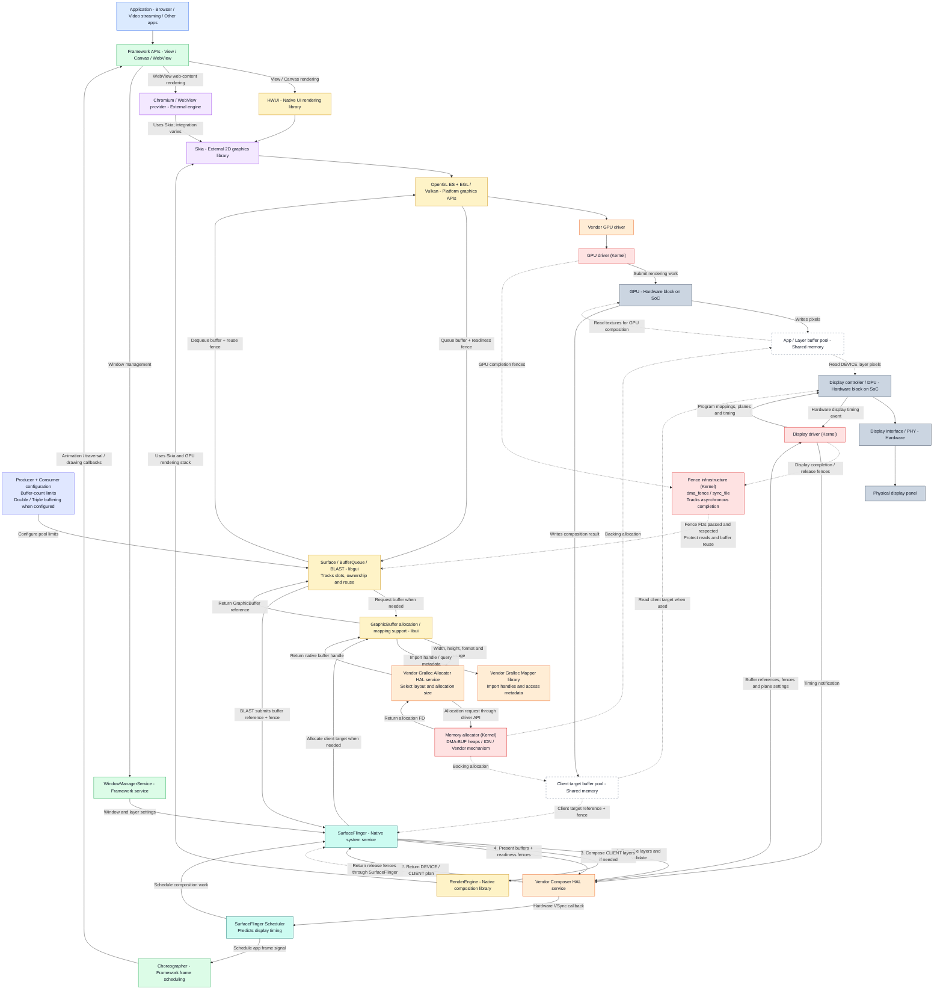

# Android Graphics

**Scope:** Android graphics, from application drawing to the physical display, including allocation, shared buffers, composition, synchronization and display timing. The diagram below preserves the supplied final version. Explanations are organized by responsibility rather than repeating the same flow in multiple summaries.

## 1. Final component diagram



| Colour | Category |
|---|---|
| Blue | Application |
| Green | Framework API/service |
| Teal | Native system service and its internal scheduling component |
| Yellow | Android native library/API implementation |
| Purple | External engine/library integrated with Android |
| Orange | Vendor driver/HAL implementation |
| Red | Kernel driver/infrastructure |
| Grey | Hardware |
| White, dashed border | Buffer memory |
| Indigo | Producer/consumer configuration |

### How to interpret this map

- This is a conceptual component/dependency map, not a literal call stack or timing trace. Arrows include calls, configuration, references, memory access and timing events as labelled.
- SurfaceFlinger, its Scheduler and RenderEngine execute in the **same SurfaceFlinger process**. Scheduler is an internal component, not a second service. libui, Skia and graphics driver libraries are loaded into each participating process as needed; shared boxes do not imply one shared instance.
- The kernel fence arrow toward BufferQueue means references are passed and respected through graphics APIs. It is not a dedicated kernel-to-BufferQueue callback channel.
- Chromium's branch is simplified: WebView integrates with HWUI, while Chrome has its own browser/compositor architecture. Video decoding, native rendering and virtualization variants are covered in section 10.
- The allocator choice and service packaging depend on the BSP. Physical RAM is not owned by an application merely because its window uses an allocation.

## 2. Framework drawing and window management

### Application, View, Canvas and WebView

An Activity constructs a UI; it is not itself a pixel buffer. A View hierarchy normally draws into a window's surface. Individual Buttons or TextViews do not each become independent SurfaceFlinger layers.

View supplies UI structure and drawing callbacks. Canvas supplies drawing operations such as rectangles, text and images. In a hardware-accelerated window, drawing is commonly recorded into RenderNode content for later rendering. A bitmap-backed Canvas can use CPU rasterization instead.

WebView is a framework API delegating web implementation to a provider. Grouping these APIs in one box identifies their architectural category, not one binary or an identical rendering implementation.

ViewRootImpl coordinates root traversal and window/surface interaction. ThreadedRenderer/HardwareRenderer bridge framework rendering to native HWUI. JNI bridges managed and native code; ART executes managed code and is not a mandatory buffer-forwarding stage.

### WindowManagerService

WMS runs in system_server. It handles window policy, layout, visibility and ordering, coordinating surface/layer state through SurfaceControl infrastructure. It does not render the Activity's text or buttons. Window-control transactions are separate from pixel-buffer production.

### Choreographer

Choreographer schedules frame callbacks for animation, input-related frame phases and View traversal on the associated Looper, normally the app's main/UI thread. It schedules work against Android's frame timeline rather than waiting for each pixel row. The origin of its timing is explained in section 9.

## 3. Native rendering engines and graphics APIs

### HWUI

HWUI is Android's native UI rendering implementation. It processes render nodes, drawing content and rendering properties, coordinates rendering resources and uses Skia to draw. UI-thread recording and native RenderThread execution cooperate; not all HWUI activity happens on one thread.

Normal apps use supported framework APIs. libhwui is a private platform interface, not a public NDK library intended for direct app linking. Its source under frameworks/base does not change its native-library classification.

### Skia

Skia is an upstream cross-platform C++ 2D graphics engine incorporated into Android. It implements paths, images, clipping, transformations, paint effects, anti-aliasing and blending; text rendering also involves Android font/text infrastructure.

A **backend** is the implementation that executes drawing through a chosen mechanism: CPU rasterization or a supported GPU API. For example, a rounded rectangle request must become geometry/shader/coverage/blending work; GLES/Vulkan do not directly supply Android Canvas-style drawRoundRect semantics.

HWUI reuses this engine instead of implementing every drawing feature independently. RenderEngine uses it for a different purpose: drawing existing layer images during composition. Skia has no mandatory dedicated thread; it executes on its caller's thread and can use supporting workers.

### Chromium / WebView provider

Chromium supplies web parsing, layout, paint and compositing infrastructure, including Blink and Skia-related rendering. WebView provider integration can span host and renderer processes. A browser is not necessarily a WebView wrapper, so the diagram's Chromium path must not be treated as the complete Chrome architecture.

### EGL, OpenGL ES and Vulkan

| Component | Responsibility | Example operations |
|---|---|---|
| EGL | Establish GLES contexts and window surfaces; integrate buffer presentation | eglCreateContext, eglMakeCurrent, eglSwapBuffers |
| OpenGL ES | Express programmable graphics work | glUseProgram, glBindTexture, glDrawArrays |
| Vulkan | Explicit resource, pipeline, command-buffer, submission and presentation control | vkCreateGraphicsPipelines, vkQueueSubmit, vkQueuePresentKHR |

OpenGL ES and Vulkan are Khronos standards. Android provides API integration and loading/dispatch; vendors supply hardware-specific implementations. Standards are not external source libraries equivalent to Skia. Vulkan uses its own surface/swapchain presentation machinery rather than requiring EGL.

GLES 1.x is the legacy fixed-function generation; GLES 2.0 introduces programmable shaders; GLES 3.x extends those capabilities. Android's GLES2 directory contains machinery supporting multiple generations.

Android 15 can use GLES or Vulkan rendering paths depending on device/configuration. App HWUI and SurfaceFlinger RenderEngine can select different backends. Vulkan's more explicit model can reduce overhead but does not guarantee better performance for every workload.

### GPU drivers and hardware

The vendor driver library in the calling process prepares resources, shaders and GPU commands. The GPU kernel driver provides device mappings and submission, coordinating scheduling and completion with hardware/firmware. The GPU executes commands and writes results into the selected destination allocation. It does not send completed image files through the kernel to SurfaceFlinger.

## 4. Gralloc: requesting and allocating graphics memory

Gralloc is Android graphics allocation/mapping infrastructure, not a Linux subsystem. Android defines interfaces; vendors implement the device-specific requirements.

| Part | Typical form | Responsibility |
|---|---|---|
| Allocator | Vendor native HAL service | Validate allocation requests, choose compatible layout and obtain backing memory |
| Mapper | Vendor library loaded by clients | Import/validate handles, expose metadata and support permitted CPU lock/unlock access |
| libui | Android native library | GraphicBuffer and allocation/mapping support used by platform clients |
| Kernel allocator | Kernel facility/driver | Supply/manage backing memory, potentially exported as DMA-BUF |

For a window buffer, Surface/BufferQueue infrastructure requests allocation through libui when a reusable suitable buffer is unavailable. EGL/Vulkan integration supplies requirements such as dimensions, pixel format and usage. SurfaceFlinger also allocates composition output buffers through graphics allocation infrastructure. Other clients include camera/media components and AHardwareBuffer users; libgui does not exclusively control Gralloc.

An example request specifies 1920 × 1080, RGBA_8888 and usage compatible with GPU rendering and display consumption. Vendor code derives stride, alignment, compression/tiling and metadata requirements, then calls a kernel allocation interface. DMA-BUF heap allocation can use a heap device plus ioctl; older BSPs may use ION or another vendor mechanism. A returned allocation FD is packaged into a native handle.

The logical uncompressed RGBA payload is 1920 × 1080 × 4 = 8,294,400 bytes, approximately 7.91 MiB. Padding and metadata can change actual allocation size. Incompatible combinations of usage, format and hardware requirements can fail. Private GPU resources such as internal textures are not all allocated through BufferQueue.

## 5. DMA-BUF and graphics-buffer identity

| Term | What it represents |
|---|---|
| Backing allocation | Memory containing pixels and possibly layout metadata |
| DMA-BUF | Kernel object/mechanism allowing an allocation to be shared across participating drivers/devices |
| DMA-BUF FD | A process-local reference to that object, not a memory address |
| Native buffer handle | File descriptors and vendor-defined handle information |
| GraphicBuffer | Android object describing/referencing a graphics allocation |
| AHardwareBuffer | Public native API representation of a hardware buffer |
| GPU/DPU device address | Device-accessible mapping established by the driver |
| BufferQueue slot | Bookkeeping entry referencing a buffer, not pixel storage itself |

Buffer A is an example name for one allocation. App FD 42 and SurfaceFlinger FD 87 can reference the same DMA-BUF; their numbers are local to their processes. GPU and DPU mappings may use different addresses for the same backing memory. Physically contiguous storage is not mandatory: suitable hardware/IOMMU mappings can support multiple backing pages.

A heap path such as /dev/dma_heap/system identifies an allocation source, not an individual image buffer. DMA-BUF itself does not specify the image's width, crop or pixel format; graphics handles/metadata and surrounding APIs convey those details.

Rendered images are pixel-buffer contents, not PNG/JPEG files. Formats can include RGBA_8888, RGBX_8888, RGBA_FP16 and video YUV formats. Logical format and physical layout differ: tiled/compressed storage need not be readable as a simple row-major RGBA byte array.

**Zero-copy handoff** means passing a reference without copying pixel bytes. It does not mean the entire pipeline uses one buffer: CLIENT composition reads app allocations and writes another allocation, the client target. Buffers can also require conversions or other intermediate processing. Access is limited by permissions, format compatibility and protected-content rules.

## 6. BufferQueue, BLAST and double/triple buffering

libgui is Android native platform code containing Surface, SurfaceControl, BufferQueue and BLASTBufferQueue infrastructure. Surface is producer-facing; SurfaceControl manipulates layer state. Neither object is the pixel allocation.

BufferQueueCore maintains slots, ownership/configuration and queue state. BufferQueueProducer and BufferQueueConsumer expose the corresponding operations. There is no universal dedicated BufferQueue thread: callers, callbacks and Binder threads execute its code with synchronization.

For a typical Android 15 Activity window, BLAST is the immediate local BufferQueue consumer and sends acquired buffers to SurfaceFlinger through transactions. Thus describing SurfaceFlinger as the direct consumer is a conceptual shorthand for this arrangement.

| Lifecycle stage | Operation | Meaning |
|---|---|---|
| FREE → DEQUEUED | dequeueBuffer | Producer obtains a slot/buffer and prior-use synchronization |
| Render | Submit drawing | Producer arranges writes into the allocation |
| DEQUEUED → QUEUED | queueBuffer | Submit reference, metadata and readiness fence |
| QUEUED → ACQUIRED | acquireBuffer | Consumer takes the queued buffer |
| ACQUIRED → FREE | releaseBuffer | Return for reuse, with any outstanding-use fence |
| DEQUEUED → FREE | cancelBuffer | Return a buffer without submitting a frame |

Allocation and rendering completion are separate: the producer can queue before the GPU finishes. Buffers survive many frames and are reused. Resize, format/usage change or teardown may retire them; final reclamation requires outstanding references/device accesses to finish.

| Buffering arrangement | Illustrative simultaneous state |
|---|---|
| Double | DPU reads A while producer renders into B |
| Triple | DPU reads A, B is queued, producer renders into C |

Producer/consumer limits determine possible counts and how many buffers can be held at once. BufferQueue manages slots; Gralloc allocates individual buffers on demand. Triple buffering is not a special allocation format or universal Android default. Extra buffers can reduce producer stalls but additional queued frames may increase latency. Each window/video surface and client-target pool has its own configuration.

## 7. Fences: completion and safe reuse

A fence tracks asynchronous completion, not image contents or ownership. Linux dma_fence and sync_file underlie common Android fence FD exchange. A buffer FD and fence FD reference different objects.

| Role | Dependency |
|---|---|
| Readiness / consumer acquire fence | Read only after the producer finishes writing |
| Release / producer reuse fence | Overwrite only after previous consumption finishes |

Drivers provide completion fences and signal corresponding work completion. Graphics libraries, BufferQueue/BLAST, SurfaceFlinger and HWC retain/pass/respect their references. A wait can be inserted into GPU/display work rather than blocking the CPU for every operation. A buffer marked available in bookkeeping can still carry an unsignaled reuse dependency.

Present and release fence semantics depend on the relevant API; they are not universal proof that every panel pixel is already visible. Passing a DMA-BUF FD does not by itself establish correct ordering, nor replace platform-specific cache-coherency requirements.

## 8. SurfaceFlinger, HWC and display output

### SurfaceFlinger and RenderEngine

SurfaceFlinger is a native C++ service in its own process. It manages layers, selects submitted content, applies ordering/crop/transform/alpha state and coordinates composition and presentation. A layer can be buffer-backed, a colour or a container; a View is not automatically a layer. Ordering includes hierarchy and relative relationships.

Scheduler and CompositionEngine are internal infrastructure. RenderEngine is a native library inside the same process, potentially with a rendering worker; it is not a standalone service. It uses Skia to draw selected input buffers into a composition output, applying supported blending, transformations and colour processing. It can support other rendering needs such as capture as well.

### Composer HAL implementation

Android defines the interface, while the vendor implements hardware-capability checks, resource assignment and presentation. Modern AIDL Composer is android.hardware.graphics.composer3; older devices can use HIDL composer interfaces. Commands may be batched rather than represented by one Binder transaction per logical operation.

The dependency order is: describe layers → validate a DEVICE/CLIENT plan → render CLIENT layers if necessary → supply presentation inputs and present. Plan/content reuse and optimized paths can avoid repeating every step on every refresh.

| Plan | What happens |
|---|---|
| DEVICE | Display hardware consumes individual supported layer buffers |
| CLIENT | RenderEngine/GPU combines designated layers into a client target |
| Mixed | Display hardware combines direct DEVICE layers with a client target |

Insufficient usable planes, unsupported layouts/formats, transforms, colour/blending requirements, bandwidth limits or vendor efficiency policy can trigger CLIENT requests. HWC reports that requirement to SurfaceFlinger; it does not directly invoke RenderEngine. Protected content needs an authorized supported path, so arbitrary GPU fallback is not guaranteed.

A client target represents all visible content only if the selected composition puts all that content into it. In mixed composition it contains a subset. With all-DEVICE composition, a newly GPU-composed client target is unnecessary.

### Display kernel driver

HWC submits buffer references, fences and configuration through a vendor display backend. On DRM/KMS systems, allocations can be imported, associated with framebuffer objects, assigned to planes and presented by atomic commit ioctls. libdrm can wrap these interfaces. Other BSP backends exist.

The driver establishes display-device memory mappings, validates the configuration and programs planes, addresses, format/stride, crop, placement, blending and timing. A DRM framebuffer object describes referenced storage; it does not inherently allocate a merged screen image. DRM planes/CRTCs/connectors are logical objects whose physical mapping is hardware-dependent.

### DPU, interface and panel

The DPU/display controller fetches pixels from memory, performs supported scaling/blending/colour processing and produces scanout. It need not write a new final framebuffer: hardware planes can be combined while generating the output stream. It does not fetch pixels directly from CPU or GPU execution units.

The display interface/transmitter/PHY carries output toward the panel using DSI, DisplayPort or another board-specific path, potentially through bridges or automotive SerDes links. Panel electronics turn that output into a visible image; electrical transfer timing and visible pixel response are not identical concepts.

Display controller is a generic term; DPU identifies a display-processing hardware block with vendor-specific boundaries. A display driver is software controlling that hardware. An audio DSP is a different programmable signal-processing block, while a framebuffer is memory.

## 9. VSync, HSync and VBlank

| Term | Meaning | Relevant operation |
|---|---|---|
| VSync | Vertical/frame synchronization timing reference | Display timing model and frame scheduling |
| HSync | Horizontal/line synchronization reference | Line timing in the lower display pipeline |
| VBlank | Interval between active frame rows of successive frames | Vertical timing and suitable configuration-latch opportunities |

A 1920 × 1080 image has 1080 active rows, each containing 1920 active pixels. HSync concerns successive line periods, not individual pixel completion. Traditional raster timing includes active pixels, front porch, sync interval and back porch; horizontal and vertical totals include blanking.

For an illustrative 1080p60 mode with 1125 total lines, the frame period is 16.67 ms, line rate is 67.5 kHz, and 45 blanking line periods take about 0.67 ms. These values depend on the selected timing mode. VSync occupies part of the vertical timing; it is not synonymous with the whole VBlank interval.

The display kernel driver configures timings, and display hardware executes them. HWC reports hardware VSync timestamps to SurfaceFlinger. Scheduler builds a timing model and schedules app/compositor work; Choreographer receives app frame signals through display-event infrastructure. It is not simply one raw hardware interrupt forwarded to every app. Hardware VSync reporting may be enabled/disabled as needed.

Normal Android APIs do not deliver per-line HSync callbacks. Linux display modes can contain hdisplay, hsync_start, hsync_end and htotal. These are programmed during mode setup/change. VBlank/frame-boundary mechanisms can help latch new display state without switching buffers mid-scanout, which can cause tearing.

Modern links may encode sync information rather than use separate wires. Command-mode panels, TE notifications and variable-refresh operation complicate the simple continuous raster model; the panel may manage internal refresh timing. Blanking does not imply a visibly black screen. None of these timing events replaces a completion fence.

## 10. Process/thread placement and alternative paths

| Component | Typical process/thread placement |
|---|---|
| Framework UI, Choreographer | App main/UI thread for ordinary View traversal |
| HWUI / Skia app rendering | App process, UI-thread recording plus RenderThread/associated work |
| WMS | system_server, Binder/service threads |
| BufferQueue / BLAST | Host process; caller/callback/Binder threads, arrangement-dependent |
| SurfaceFlinger / Scheduler / RenderEngine | One service process, multiple internal threads |
| Gralloc Allocator | Vendor HAL process, implementation-dependent workers |
| Mapper | Library in each importing client process |
| HWC | Vendor composer process with Binder/implementation threads |
| Kernel drivers | Kernel execution, interrupts/workers and hardware/firmware interaction |

Native services are executing processes; native libraries supply code loaded into processes. A component name does not imply its own process or thread. Source-directory placement does not determine process placement.

| Variant | Departure from the main diagram |
|---|---|
| Hardware video decoder → SurfaceView | Decoder supplies a separate surface's video buffers; no mandatory Skia pass over video pixels |
| TextureView video | Video texture is sampled into the app's rendered content |
| Native GLES/Vulkan application | Can produce buffers without HWUI/Skia |
| CPU bitmap drawing | CPU writes rasterized pixels |
| Virtual display | Output can target a buffer/encoder rather than a panel |
| Automotive hypervisor | Android can submit to a virtual backend/host compositor owning physical display hardware |

## 11. Source paths and target checks

| Component | Source location |
|---|---|
| View / Choreographer | frameworks/base/core/java/android/view/ |
| Canvas | frameworks/base/graphics/java/android/graphics/ |
| WebView API | frameworks/base/core/java/android/webkit/ |
| WMS | frameworks/base/services/core/java/com/android/server/wm/ |
| HWUI | frameworks/base/libs/hwui/ |
| Skia | external/skia/ |
| Chromium WebView | Chromium repository: android_webview/ |
| EGL | frameworks/native/opengl/libs/EGL/ |
| GLES dispatch | frameworks/native/opengl/libs/GLES2/ and GLES_CM/ |
| Vulkan loader | frameworks/native/vulkan/libvulkan/ |
| Vulkan headers | external/vulkan-headers/ |
| libgui / BufferQueue / BLAST | frameworks/native/libs/gui/ |
| libui / GraphicBuffer | frameworks/native/libs/ui/ |
| Allocator / Mapper interfaces | hardware/interfaces/graphics/allocator/ and graphics/mapper/ |
| SurfaceFlinger / Scheduler / CompositionEngine | frameworks/native/services/surfaceflinger/ |
| RenderEngine | frameworks/native/libs/renderengine/ |
| Composer AIDL | hardware/interfaces/graphics/composer/aidl/ |
| Qualcomm display examples | BSP drivers/gpu/drm/msm/sde/ or separate display-drivers module |
| Upstream Qualcomm DPU | drivers/gpu/drm/msm/disp/dpu1/ |

Typical platform binaries include libhwui.so, libgui.so, libui.so, libEGL.so, libGLESv2.so/libGLESv3.so and libvulkan.so. Skia and librenderengine can be linked into clients; separate installed shared objects are not guaranteed. Vendor implementation paths/service names vary.

### dpu verification

Do not infer a specific DPU IP revision from the SoC name alone. Qualcomm uses MDSS for a broader display subsystem and SDE/DPU terminology for display processing. Correlate active device tree, driver discovery and hardware catalog; in a virtualized system check the host that owns the hardware.

```bash
# Android display state and app renderer
adb shell dumpsys display
adb shell dumpsys SurfaceFlinger
adb shell dumpsys gfxinfo com.example.testapp
adb shell wm size
adb shell wm density
adb shell getprop debug.hwui.renderer
adb shell getprop ro.hwui.use_vulkan

# Driver discovery; logs may require authorized debug/root access
adb shell 'dmesg | grep -iE "mdss|sde|dpu|drm|dsi|displayport|panel|hw.rev"'
adb shell ls /sys/class/drm
adb shell ls /dev/dri

# Read-only DRM query if modetest is installed and accessible
adb shell modetest -M msm -c -p
```

An empty property does not prove the active renderer. App gfxinfo does not identify RenderEngine's backend. wm density is UI density, not a physical-PPI measurement. DRM connector modes enumerate possibilities, not necessarily the active mode.

From the BSP root:

```bash
rg -n -i 'qcom,.*(mdss|sde|dpu)|qcom,mdss-dsi-panel-name' \
  --glob '*.dts' --glob '*.dtsi'
rg -n 'sde_hw_catalog_init|SDE_HW_VER_|hw_rev|dpu_hw_catalog' \
  --glob '*.[ch]'
```

Follow the active board's includes and overlays; an unused matching DTS file is not proof about the target.

## 12. Primary references

Online documentation can cover newer behavior than an Android 15 vendor BSP. Consult the exact release source for implementation details.

- [AOSP architecture](https://source.android.com/docs/core/architecture)
- [BufferQueue and Gralloc](https://source.android.com/docs/core/graphics/arch-bq-gralloc)
- [EGL and OpenGL ES](https://source.android.com/docs/core/graphics/arch-egl-opengl)
- [Vulkan](https://source.android.com/docs/core/graphics/arch-vulkan)
- [Hardware Composer](https://source.android.com/docs/core/graphics/hwc)
- [AIDL Composer HAL](https://source.android.com/docs/core/graphics/aidl-hwc)
- [Skia](https://skia.org/docs/)
- [Chromium WebView architecture](https://chromium.googlesource.com/chromium/src/+/HEAD/android_webview/docs/architecture.md)
- [Linux DMA-BUF and synchronization](https://docs.kernel.org/driver-api/dma-buf.html)
- [Linux DRM/KMS](https://docs.kernel.org/gpu/drm-kms.html)
- [AOSP native sources](https://android.googlesource.com/platform/frameworks/native/)
