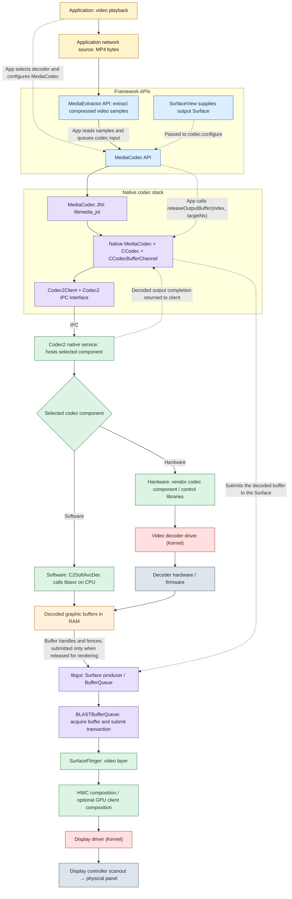

# Android online MP4 video playback

Based on [VideoPlayerActivity.java](https://github.com/mertechlog/android-platform-graphics/blob/main/sample/VideoPlayerActivity.java), Scope: direct HTTP(S) MP4 **video-only** playback into a `SurfaceView`.

## 1. Architecture

Your diagram is correct as a simplified **modern Codec2 + BLAST** path. The adjustments below make output completion and application-controlled Surface submission explicit. The sample's Java APIs do not force this native backend on every device: API 28+ support does not guarantee Codec2 or BLAST. Vendor implementation and Android version determine service names, transport and drivers.

Solid arrows show media/buffer progression and execution; dotted arrows show control or completion. This is a functional diagram, not a map of separate processes. The software/hardware diamond represents the component already selected during decoder creation; it is not a decision repeated for every frame.

**Colors:** yellow = application code; blue = framework APIs; purple = native libraries; green = native services/components; red = kernel; gray-blue = hardware; orange = buffers. The composition box groups multiple components rather than representing a single service.

## 2. Application and framework responsibilities

| Component | Job in the reference sample |
| --- | --- |
| `VideoPlayerActivity` / `SurfaceHolder.Callback` | Creates the view on the UI thread and starts playback only when the activity is resumed and the Surface is valid. Pause or Surface destruction cancels the session. |
| `Session.worker` (`MP4-extract-decode`) | Performs the extraction and synchronous codec loop, handles end-of-stream, and releases resources. |
| `HttpRangeSource extends MediaDataSource` | Uses `HttpURLConnection` / `InputStream` to request MP4 byte ranges and maintains a 256 KiB cache. `readAt()` supplies requested file offsets to the extractor; framework callback threads may invoke it. |
| `MediaExtractor` | Uses Android's native container parser, typically through the extractor service, to expose tracks and extract compressed samples. MP4 is a container; the selected video track determines the codec. |
| `MediaFormat` / `MediaCodecList` | The app reads MIME type, dimensions and initialization data, finds a compatible decoder, and creates it with `MediaCodec.createByCodecName()`. Selection does not explicitly force software or hardware. |
| `MediaCodec` | Receives `configure(format, surface, null, 0)` followed by `start()`. The worker fills input `ByteBuffer`s using `readSampleData()`, queues sample size and presentation time, then dequeues output notifications. |
| `SurfaceView` / `SurfaceHolder` / `Surface` | Supplies the configured output destination for a separately composed video layer. The Surface is the producer endpoint for buffer submission. |

The sample manually connects these APIs; it does not use `MediaPlayer` or ExoPlayer. It selects only the video track and has no audio playback path.

## 3. Native decoding

`libmedia_jni` bridges Java calls to native `MediaCodec`. With Codec2, `CCodec` manages codec state, `CCodecBufferChannel` manages input/output and Surface submission, and `Codec2Client` communicates with the selected native codec service. The IPC interface is a contract and proxy boundary; the service is the process hosting the component.

| Path | Component responsibility | Actual decoding |
| --- | --- | --- |
| Software H.264/AVC example | `C2SoftAvcDec` wraps and calls `libavc`, a native decoding library loaded into the service process. | CPU cores execute the library's decoding instructions. Other video formats use their corresponding components and libraries. |
| Hardware | Vendor Codec2 component/control libraries configure buffers and decoder jobs through the video decoder driver **(Kernel)**. | Dedicated decoder hardware, assisted by firmware where applicable, reconstructs the images. The exact work split is vendor-specific. |

Codec service threads operate independently of the app worker. Software decoding still uses kernel scheduling, memory management, IPC and buffer synchronization; it does not require a dedicated video-decoder driver for its decoding calculation. Networking also uses the socket/TCP/IP stack and network drivers **(Kernel)**.

## 4. Output release and playback timing

After `dequeueOutputBuffer()` returns an index, the app holds that codec output until it releases it. With Surface output, the index represents a decoded output; the app does not read pixel bytes through `getOutputBuffer()`.

| Call | Effect |
| --- | --- |
| `releaseOutputBuffer(index, false)` | Returns the output without presenting it. |
| `releaseOutputBuffer(index, true)` | Returns the output and requests rendering to the configured Surface. |
| `releaseOutputBuffer(index, targetNs)` | Returns the output and requests rendering with a presentation time in the `System.nanoTime()` time base. |

The reference sample derives `targetNs` from `BufferInfo.presentationTimeUs`, waits using its standalone video clock, then makes the timed release call. Native codec code queues the buffer for the display consumer; the app does not directly notify BufferQueue. The requested time is not a guarantee of the exact physical scanout instant.

**Release means hand back control, not delete the image.** If the app keeps successfully dequeued outputs without releasing them, available output buffers eventually run out, decoding stalls, and input processing can stall too. Frames held this way are not submitted for display. During normal playback, every successfully dequeued output must be released, including outputs the app discards.

## 5. Memory and physical display

The network cache contains **MP4 container bytes**; codec inputs contain **compressed video samples**; decoder outputs contain **decoded image planes**, commonly YUV. Both software and hardware Surface decoding ultimately provide display-compatible graphic buffers in RAM. Their layout can be vendor-specific, and copies or format conversion may occur.

Gralloc allocator/mapper support creates and imports graphic allocations. Native handles and `GraphicBuffer` describe those allocations; DMA-BUF commonly enables sharing through the kernel. DMA-BUF is not a separate physical memory location, and an ordinary Java byte array is not automatically a DMA-BUF. Fences synchronize producer completion and safe consumer access.

BufferQueue, implemented in `libgui`, tracks slots, handles, ownership and synchronization rather than copying every frame's pixels into a new queue-owned array. In the BLAST path, BLAST acquires the queued buffer and attaches it to a `SurfaceControl` transaction for SurfaceFlinger.

SurfaceFlinger coordinates composition with HWC. A supported video layer can use a display plane directly; when GPU client composition is required, RenderEngine uses graphics drivers and the GPU to produce a client target for HWC. That optional route includes a GPU driver **(Kernel)**. The display driver **(Kernel)** programs the display controller, which reads scanout buffers and drives the panel; DRM/KMS or vendor-specific interfaces may be used.

WindowManager/SurfaceControl establish geometry, visibility and ordering. The video's pixels do not need to be rendered through the app's Canvas/HWUI/Skia path; its video layer meets other visible layers during system composition.

## References

- [Reference application](https://github.com/mertechlog/android-platform-graphics/blob/main/sample/VideoPlayerActivity.java)
- [MediaDataSource API](https://developer.android.com/reference/android/media/MediaDataSource)
- [MediaExtractor API](https://developer.android.com/reference/android/media/MediaExtractor)
- [MediaCodec API](https://developer.android.com/reference/android/media/MediaCodec)
- [AOSP C2SoftAvcDec implementation](https://android.googlesource.com/platform/frameworks/av/+/refs/heads/main/media/codec2/components/avc/C2SoftAvcDec.cpp)
- [AOSP CCodecBufferChannel implementation](https://android.googlesource.com/platform/frameworks/av/+/master/media/codec2/sfplugin/CCodecBufferChannel.cpp)
- [AOSP BLASTBufferQueue implementation](https://android.googlesource.com/platform/frameworks/native/+/refs/heads/main/libs/gui/BLASTBufferQueue.cpp)
- [BufferQueue and Gralloc](https://source.android.com/docs/core/graphics/arch-bq-gralloc)
- [SurfaceView architecture](https://source.android.com/docs/core/graphics/arch-sv-glsv)
- [SurfaceFlinger and WindowManager](https://source.android.com/docs/core/graphics/surfaceflinger-windowmanager)
